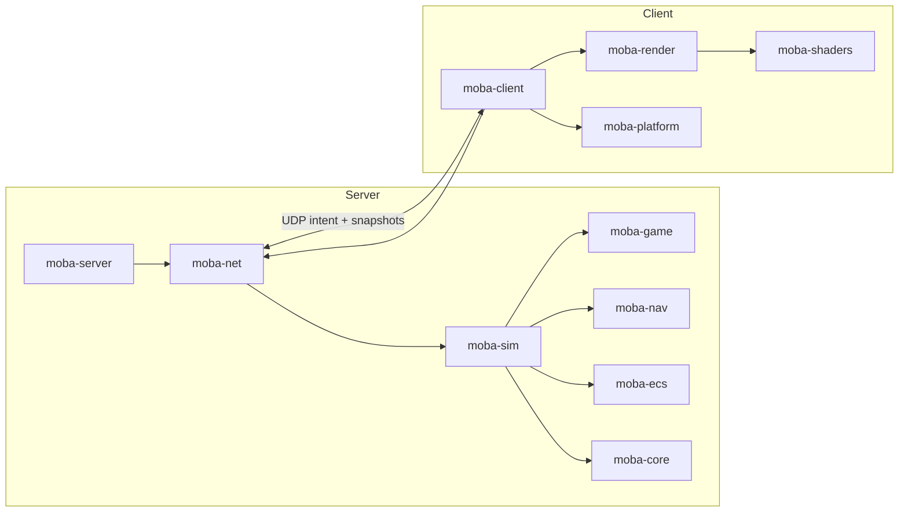

# MOBA Engine

A server-authoritative multiplayer MOBA engine written in Rust and Vulkan.

> **Status: preview (0.1).** The engine is playable end-to-end — dedicated server, UDP
> netcode, deterministic simulation, Vulkan client with HUD and fog of war — but the public
> API is pre-1.0 and content is compile-time. See [API stability](docs/API-STABILITY.md).


## What is in the box

| Area | Capability |
|---|---|
| Simulation | Deterministic 30 Hz 5v5 MOBA, three lanes, towers/nexus, 5 heroes × 3 abilities, minions, bots, respawns, levels/XP, gold, items and a shop |
| Networking | Custom UDP protocol: handshake, intent input, fragmentation, server-authoritative delta snapshots, visibility filtering, local-hero prediction, remote interpolation and a lossy-link conditioner |
| Client | Vulkan 1.2 renderer with instanced units, terrain fog of war, screen-space bitmap HUD, Tab scoreboard, shop and mouse/keyboard controls |
| Server | Headless authoritative runner; bots fill empty slots; bandwidth and tick statistics |
| Quality | Fixed-point determinism tests, ECS/job benchmarks, Miri, layered architecture, 116 tests, wire fuzzing and a 5-minute 10-client soak |

## Quick start

Requirements: Rust 1.85+, a Vulkan 1.2 driver, and `glslc` (Vulkan SDK or
`glslang-tools`) to build shaders. Linux, Windows and macOS (MoltenVK) are supported.

```bash
# 1. Headless match (no GPU required)
cargo run --release -p moba-server -- --ticks 20000

# 2. Dedicated server + playable client
cargo run -p moba-server -- --listen 127.0.0.1:7777 --seconds 600
MOBA_SERVER=127.0.0.1:7777 cargo run -p moba-client
```

Or run a self-contained loopback match (spawns a local server inside the client):

```bash
MOBA_SERVER=local cargo run -p moba-client
```

**Controls:** right-click move, left-click attack, Q/W/E cast at the cursor, Space stop,
B shop (1–8 buy), Tab scoreboard, Escape quit.

Useful client variables: `MOBA_CAPTURE=frame.ppm`, `MOBA_CAPTURE_FRAME=N`,
`MOBA_SMOKE_FRAMES=N`, `MOBA_VULKAN_VALIDATION=required|off`, `MOBA_DEMO_MOVE=x,y`,
`MOBA_DEMO_BUY=<item>`, `MOBA_SHOP=1`.

## Architecture



The server and simulation never depend on rendering, windowing, `ash` or `winit`; CI
enforces the layering. `moba-core` and `moba-ecs` are the reusable foundation; `moba-game`
and `moba-sim` are content/game rules; `moba-net` is transport + protocol; `moba-render`
and `moba-platform` are presentation.

Read [docs/architecture.md](docs/architecture.md) for data flow, determinism, netcode and
the extension points.

## Workspace

| Crate | Role |
|---|---|
| `moba-engine` | Umbrella entry point with `sim`, `net` and optional `render` features |
| `moba-core` | Q32.32 fixed-point math, RNG, arenas, bitsets, time, hashing |
| `moba-ecs` | Generational SoA archetype ECS, change ticks, item/chunk queries |
| `moba-jobs` | Scoped work-stealing job pool |
| `moba-game` | Data tables and pure rules: heroes, abilities, units, map, items, progression |
| `moba-sim` | Deterministic authoritative simulation |
| `moba-nav` | Spatial grid |
| `moba-net` | UDP transport, protocol, prediction, snapshots |
| `moba-netsim` | Link conditioner for tests |
| `moba-platform` | winit window/input/fixed step |
| `moba-render` | Vulkan renderer, terrain, fog, HUD batch |
| `moba-shaders` | GLSL → validated SPIR-V |
| `moba-server` | Dedicated server binary |
| `moba-client` | Playable client binary |
| `moba-tools` | Soak tester and wire fuzzer |

## Embedding

Add the umbrella crate for a headless tool/server:

```toml
moba-engine = { version = "0.1", default-features = false, features = ["sim", "net"] }
```

or take individual crates (`moba-sim`, `moba-net`, …) for a narrower dependency graph.
Runnable examples live in `crates/tools/examples`:

```bash
cargo run -p moba-tools --example headless_match -- --ticks 3000
cargo run -p moba-tools --example scripted_orders
cargo run -p moba-tools --example custom_component
```

## Extending

- **Content:** heroes, abilities, items, level growth and economy live in `moba-game` tables.
  Today content is compile-time; [docs/content-authoring.md](docs/content-authoring.md) walks
  through adding an item/hero and the planned runtime content packs (M8).
- **Rules/simulation:** depend on `moba-sim` and drive it from a custom server or tool. The
  simulation consumes intent only and never reads a clock or a hash map. `world()`/`world_mut()`
  expose the ECS for custom components, inspectors and alternate modes.
- **Presentation:** replace `moba-render`/`moba-platform` with another renderer; the
  simulation and netcode are independent.
- **Transport/protocol:** `moba-net` is versioned and field-masked; transport, snapshot model
  and prediction are separate modules.

## Quality gates

```bash
cargo fmt --all --check
cargo clippy --workspace --all-targets --locked -- -D warnings
cargo test --workspace --locked
cargo doc --workspace --no-deps
just soak          # five-minute 10-client lossy soak
just fuzz-wire     # one-hour deterministic wire fuzzing
```

See [CONTRIBUTING.md](CONTRIBUTING.md) for the full workflow, layering rules and review
expectations.

## Security

The preview protocol is **not encrypted or authenticated**; run it on a trusted LAN only.
See [SECURITY.md](SECURITY.md).

## License

Dual-licensed under either of [Apache-2.0](LICENSE-APACHE) or [MIT](LICENSE-MIT), at your
option. Contributions are accepted under the same terms.
