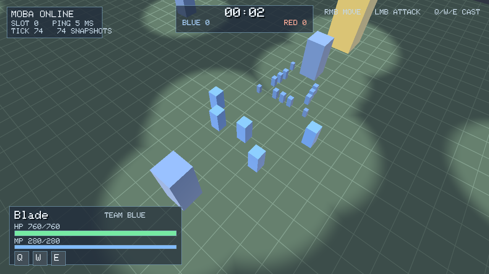
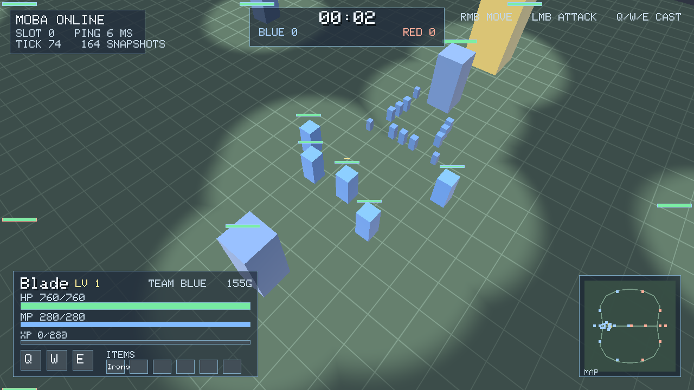
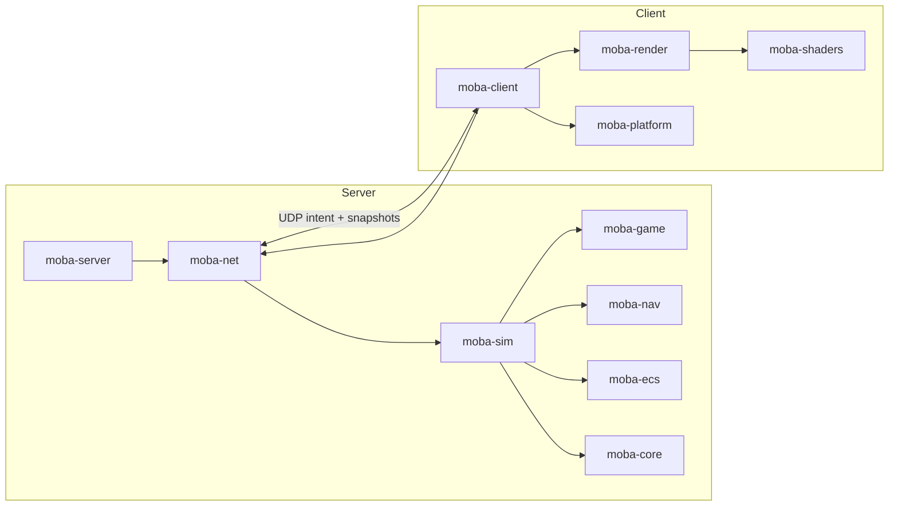

# MOBA Engine

[](https://github.com/JakeGT/moba-engine/actions/workflows/ci.yml)
[](https://github.com/JakeGT/moba-engine/issues)

A server-authoritative multiplayer MOBA engine written in Rust and Vulkan. Current contract:
wire protocol **v41**, replay format **v5** (simulation logic **v8**), workspace **0.4.0**.

> **Status: preview (0.4.0).** The engine is playable end-to-end — dedicated server, UDP
> netcode, deterministic simulation, Vulkan client with HUD and fog of war — but the public
> API is pre-1.0 and content packs are validated runtime TOML. See [API stability](docs/API-STABILITY.md).





[See the full screenshot gallery](docs/screenshots.md) for the renderer, HUD, fog-of-war,
spectator camera, status effects and runtime-content examples.

## What is in the box

| Area | Capability |
|---|---|
| Simulation | Deterministic 30 Hz MOBA (5v5 default, 1v1/ARAM packs), three lanes, towers/nexus, heroes/abilities, minions, vision-respecting bots, respawns, rules, levels/XP, gold, items and shop |
| Networking | Custom UDP protocol (v41): handshake, intent input, fragmentation, server-authoritative delta snapshots, visibility filtering, prediction/interpolation, reconnect, spectators, between-match catalogue updates and content attestation |
| Client | Vulkan 1.3 renderer (render graph, HDR target, AgX tonemap, quality tiers, per-pass GPU timing, compute GPU-particle VFX bound to presentation events) with instanced units/animated hero rig, map themes, wall LOS/fog, textured HUD/icons, MSDF text, 3D hero portraits and a baked minimap rendered to texture, settings/remapping/UI scale, procedural audio, paginated shop, scoreboard and free-pan spectator camera |
| Server | Headless authoritative runner; bots fill empty slots; bandwidth and tick statistics |
| Quality | Fixed-point determinism tests, ECS/job benchmarks, Miri/Loom, cargo-fuzz, layered architecture, 702 tests, golden-image CI and a 5-minute 10-client soak |

## Quick start

Requirements: Rust 1.88+, a Vulkan 1.3 driver, and `glslc` (Vulkan SDK or
`glslang-tools`) to build shaders. Linux, Windows and macOS (MoltenVK) are supported.

```bash
# 1. Headless match (no GPU required)
cargo run --release -p moba-server -- --ticks 20000

# 2. Dedicated server + playable client
cargo run -p moba-server -- --listen 127.0.0.1:7777 --seconds 600
MOBA_SERVER=127.0.0.1:7777 cargo run -p moba-client
```

Or run a self-contained loopback match (spawns a local server inside the client):

```bash
MOBA_SERVER=local cargo run -p moba-client
MOBA_CONTENT=content/aram.toml cargo run -p moba-client   # local preview of a pack
```

**Controls:** right-click move, left-click attack, Q/W/E cast at the cursor, Space stop,
R ready up in the lobby, F5 surrender vote, B shop (click/1–8 buy, hover tooltip, Left/Right page), hover Q/W/E for details, click minimap to move, Tab scoreboard,
Escape quit. `MOBA_SPECTATE=1` joins read-only with full-map visibility; WASD pans, arrows
rotate/zoom the spectator camera.

**Settings:** copy `moba-settings.example.toml` to `moba-settings.toml` (or set
`MOBA_SETTINGS=/path/to/file`). Bindings accept `W/A/S/D/Q/E/R/F/B/M/Space/Tab/Enter/Escape/
Arrows/F1–F5/1–8`; invalid or duplicate values fall back to defaults. `ui_scale` is 0.5–3.0;
`MOBA_UI_SCALE` overrides it for one run; HUD text is a signed-distance-field font, so it
stays sharp at any scale. `team_palette` (`standard` or `colorblind`, default `standard`) picks
the health-bar and minimap team colours; `colorblind` uses Okabe-Ito yellow/sky-blue/orange,
and `MOBA_TEAM_PALETTE` overrides it. `quality` (`low`/`medium`/`high`/`ultra`, default
`high`) is the rendering quality tier; `MOBA_QUALITY` overrides it. Today it picks the HDR
target format (Low uses the packed 32-bit format) and the hero-portrait rate (static on Low,
re-rendered only when the heroes change; `MOBA_PORTRAITS=off|static|animated|<hz>` and `MOBA_MINIMAP_BAKE=off|once` switch
the portraits and the baked minimap). `audio_volume` (0–1), `audio_mute`, `camera_sensitivity` (0.25–3.0), `camera_zoom`
(70–420), `attack_button` (`left`/`right`) and spectator camera keys are also configurable.
`MOBA_SAVE_SETTINGS=1` writes defaults; `MOBA_RESET_SETTINGS=1` resets the file.
`MOBA_FRAME_LOG=/tmp/frames.log MOBA_VSYNC=0` records raw frame intervals and writes
p50/p95/p99/max on exit, plus per-pass GPU times from timestamp queries (`gpu_scene_*`,
`gpu_composite_*`, `gpu_ui_*`, `gpu_total_*`; see `docs/perf/0007-real-hardware.md` and
`docs/perf/0011-render-graph.md`) and how the pipelines were built (`pipelines`,
`pipeline_build_ms`, `pipeline_cache=cold|warm|...`). Pipelines are cached per user
(`MOBA_PIPELINE_CACHE=<file>` or `off`; default under the platform cache directory).
`MOBA_COMPRESSED_TEXTURES=0` decodes BC textures on the CPU (the path for GPUs without BC
support). Debug builds only: `MOBA_SHADER_DIR=<dir>` loads SPIR-V overrides (`<module>.spv`, e.g.
`unit_textured.frag.spv`, built with `glslc --target-env=vulkan1.3 -I
crates/shaders/shaders/include [-DMATERIAL_TEXTURED]`) and rebuilds the scene and composite
pipelines when one changes. Materials and textures: `docs/content-authoring.md`.

Matches run a lobby → 3-second countdown → gameplay → results → automatic rematch loop.
Disconnected players keep their slot for a 60-second grace period while a bot covers, and can
resume with `NetClient::connect_with_session(server, timeout, session)` using
`NetClient::session()`. The dedicated server exposes `--countdown S` and `--results S`.

### Runtime content packs

Servers can load validated TOML item, hero, ability and map definitions and publish them to clients in the handshake:

```bash
cargo run -p moba-server -- --listen 127.0.0.1:7777 --seconds 600 --items content/items.toml
MOBA_SERVER=127.0.0.1:7777 cargo run -p moba-client
```

Packs carry `name`/`version`/`author` metadata; replays record the pack identity alongside the
content hash. The client shop/HUD, cooldowns, range/radius overlays, vision and minimap use the received complete catalogue, verified against `GameContent::hash`; simulation purchases, hero stats, ability effects and map geometry use the same definitions.

`--reload-content` watches the pack and broadcasts a catalogue update to connected clients in
the lobby/results phase (never mid-match). The pack is loaded and trust-checked once per
process and shared by every match; replace it atomically (write a temporary file, then
`mv`/`rename` it over the watched path).
Servers with repeated `--items FILE` rotate maps between empty-lobby matches and announce the
selected map. Client identity keys can be rotated/revoked with `--rotate-client-key OLD:NEW` and
`--revoke-client-key KEY`. Signed packs can be required with `--require-content-attestation --content-publisher HEX`
(see `docs/content-authoring.md`).
Names are 1–16 ASCII bytes, costs must be positive, packs hold at most 16 items, 8 heroes, 24 abilities, 4 lanes and 32 structures, and hero ability slots reference
catalogue ids. Packs can select a built-in map theme, carry an Ed25519 publisher
attestation and rotate between empty-lobby matches. See
[content/example-pack.toml](content/example-pack.toml),
[content/ability-pack.toml](content/ability-pack.toml),
[content/map-pack.toml](content/map-pack.toml),
[content/1v1-mid.toml](content/1v1-mid.toml),
[content/aram.toml](content/aram.toml) and
[content authoring](docs/content-authoring.md).

### Server configuration

Dedicated servers can be configured with TOML; CLI flags override file values:

```bash
cargo run -p moba-server -- --config server.example.toml
```

See [server.example.toml](server.example.toml) for listen/duration, ready, rate-limit,
content, replay and secret/identity paths.

### Server hardening

The dedicated server enforces a per-address UDP budget (default 120 packets/s, burst 120);
raise/lower with `--max-pps N` or disable with `0`. Every datagram is charged straight after
`recv_from`, before header decode, decryption or fragment reassembly, so undecodable junk
counts against its sender too. A per-match budget (`--max-total-pps`, default 2000) caps
distributed/spoofed-source floods, and `--host-max-pps N` adds an optional budget shared by
every match in the process. With `--matches N`, each worker polls its sockets round-robin and
caps every match at 64 datagrams or 500 µs per pass, so a flood on one port cannot starve the
other matches on that worker; measured in [perf/0010](docs/perf/0010-multi-match.md#flood-isolation).
Ctrl-C/SIGINT requests a graceful shutdown and flushes an in-progress replay.
`--results-log matches.jsonl` appends one JSON record per completed match (seed, ticks,
score, content/state hashes and replay path). The server
reports drop counts plus average/max simulation tick time in its final stats. Rate limiting is application-layer
defence: a spoofed-source flood on one port can still starve new handshakes on that port, so put public servers behind a DDoS/connection gateway as well.

### Encrypted private servers

Generate a 32-byte key and pass the same 64-hex secret to both sides:

```bash
SECRET=$(openssl rand -hex 32)
cargo run -p moba-server -- --listen 127.0.0.1:7777 --seconds 600 --secret "$SECRET"
MOBA_SECRET="$SECRET" cargo run -p moba-client
```

This enables the authenticated ChaCha20-Poly1305 session mode; see [SECURITY.md](SECURITY.md)
for its scope and limitations.

For per-player access, the server accepts a key ring (`--allow-token HEX`, repeatable; or
`client_tokens` in the TOML config). Each client uses its own token via `MOBA_SECRET`; tokens
authenticate the Hello, derive that player's encryption key, and can be revoked by removing
them from the ring and restarting.

Servers can require **client Ed25519 identities** with
`--allow-client-key <public key>` (repeatable) / `client_identity_keys` in TOML. Clients set
`MOBA_CLIENT_IDENTITY=<seed hex>` and answer a per-connection server challenge; unlisted or
missing keys are rejected.

Servers can also present a pinned Ed25519 identity. Generate a seed, start the server, and pin
the printed public key:

```bash
openssl rand -hex 32 > server.seed
cargo run -p moba-server -- --listen 0.0.0.0:7777 --seconds 600 --server-key server.seed
# prints identity=<64 hex>; clients pin it with:
MOBA_SERVER_PUBKEY=<64 hex> cargo run -p moba-client
```

A pinned client rejects an unsigned or wrongly-signed Welcome; unpinned clients remain
compatible.

Validate content and run the deterministic match harness:

```bash
cargo run -p moba-tools --bin content-check -- content/example-pack.toml
cargo run --release -p moba-tools --bin match-soak -- --matches 50
```

`match-soak` rotates team compositions, replays each seeded bot match twice, checks
determinism and reports tick timing and outcome distribution (`--fixed-picks` for one comp).

Deterministic replays can be recorded by the server and verified offline:

```bash
cargo run -p moba-server -- --listen 127.0.0.1:7777 --seconds 600 --ready --record match.mbr
cargo run -p moba-tools --bin replay -- match.mbr
# custom content pack used by the match:
cargo run -p moba-tools --bin replay -- --items content/example-pack.toml match.mbr
```

Replays store the seed/config, content manifest, exact per-tick inputs and periodic state
checkpoints; the verifier reports the first divergent tick and reproduces the final state
hash. Useful client variables: `MOBA_CAPTURE=frame.ppm`, `MOBA_CAPTURE_FRAME=N`,
`MOBA_SMOKE_FRAMES=N`, `MOBA_VULKAN_VALIDATION=required|off`, `MOBA_DEMO_MOVE=x,y`,
`MOBA_DEMO_BUY=<item>`, `MOBA_SHOP=1`, `MOBA_CAMERA_DISTANCE=<m>` (player, spectator
and replay camera), `MOBA_LOCAL_CAMERA_DISTANCE=<m>` (local bot preview overview),
`MOBA_CAPTURE_TICK=N` (networked capture at match tick N, repeatable with `MOBA_SERVER=local`),
`MOBA_WINDOW_SIZE=<w>x<h>`, `MOBA_WARMUP_TICKS=N` (network mode: frame log starts at tick N);
hero models: a pack's
`heroes.model` names load `<MOBA_ASSET_ROOT>/models/<model>.glb` (default root `content`, see
`content/sentinel-pack.toml`; `MOBA_HERO_MODELS=<hero>=<model>,...` overrides per hero), and
`MOBA_CONTENT=<pack.toml>` plays a pack in the local preview or `MOBA_SERVER=local`. A model
with a skin is GPU-skinned and walks with the hero; `MOBA_NO_SKINNING=1` draws it static. A
map's `visuals` name loads the descriptor `<MOBA_ASSET_ROOT>/maps/<name>.toml` (terrain tint,
walls, props; see `content/ember-map.toml` and
[map visuals](docs/content-authoring.md#map-visuals)), and `MOBA_CAPTURE_MAPS=<prefix>` writes
one capture per map in a network session.

## Architecture



The server and simulation never depend on rendering, windowing, `ash` or `winit`; CI
enforces the layering. `moba-core` and `moba-ecs` are the reusable foundation; `moba-game`
and `moba-sim` are content/game rules; `moba-net` is transport + protocol; `moba-render`
and `moba-platform` are presentation.

Read [docs/architecture.md](docs/architecture.md) for data flow, determinism, netcode and
the extension points.

## Workspace

| Crate | Role |
|---|---|
| `moba-engine` | Umbrella entry point with `sim`, `net` and optional `render` features |
| `moba-core` | Q32.32 fixed-point math, RNG, arenas, bitsets, time, hashing |
| `moba-ecs` | Generational SoA archetype ECS, change ticks, item/chunk queries |
| `moba-jobs` | Scoped work-stealing job pool |
| `moba-game` | Data tables and pure rules: heroes, abilities, units, map, items, progression |
| `moba-sim` | Deterministic authoritative simulation |
| `moba-nav` | Spatial grid |
| `moba-net` | UDP transport (optional PSK AEAD), protocol, reconnect, prediction, snapshots and content catalogue |
| `moba-netsim` | Link conditioner for tests |
| `moba-platform` | winit window/input/fixed step |
| `moba-render` | Vulkan renderer, terrain, fog, HUD batch, render-to-texture HUD images |
| `moba-shaders` | GLSL → validated SPIR-V |
| `moba-server` | Dedicated server binary |
| `moba-client` | Playable client binary |
| `moba-tools` | Soak tester, wire fuzzer and replay verifier |

## Embedding

Add the umbrella crate for a headless tool/server:

```toml
moba-engine = { version = "0.2", default-features = false, features = ["sim", "net"] }
```

or take individual crates (`moba-sim`, `moba-net`, …) for a narrower dependency graph.
Runnable examples live in `crates/engine/examples`:

```bash
cargo run -p moba-engine --example headless_match
cargo run -p moba-engine --example custom_content
```

More embedding patterns (custom ECS systems, content, server hosting, replays) are in
[docs/building-on-moba.md](docs/building-on-moba.md).

## Extending

- **Content:** runtime TOML packs define items, heroes, abilities, growth, lanes, structures
  and vision walls; validated packs are hashed and exchanged in the handshake. See
  [docs/content-authoring.md](docs/content-authoring.md) and the example packs in
  [`content/`](content/).
- **Rules/simulation:** depend on `moba-sim` and drive it from a custom server or tool. The
  simulation consumes intent only and never reads a clock or a hash map. `world()`/`world_mut()`
  expose the ECS for custom components, inspectors and alternate modes.
- **Presentation:** replace `moba-render`/`moba-platform` with another renderer; the
  simulation and netcode are independent.
- **Transport/protocol:** `moba-net` is versioned and field-masked; transport, snapshot model
  and prediction are separate modules.

## Quality gates

```bash
cargo fmt --all --check
cargo clippy --workspace --all-targets --locked -- -D warnings
cargo test --workspace --locked
RUSTDOCFLAGS="-D warnings" cargo doc --workspace --no-deps --locked
scripts/agent-verify.sh          # portable fast gate
scripts/agent-verify.sh --full   # release/features/Loom/soak/fuzz
```

See [CONTRIBUTING.md](CONTRIBUTING.md) for the full workflow, layering rules and review
expectations. Agent-facing instructions are in [AGENTS.md](AGENTS.md) and the operational
runbook [docs/agents.md](docs/agents.md). Current status and known blockers are in
[docs/status.md](docs/status.md); unfinished work is tracked in
[GitHub Issues](https://github.com/JakeGT/moba-engine/issues).

## Security

Plaintext is the default for LAN development. Optional pre-shared-key mode authenticates the
handshake and encrypts packet payloads (ChaCha20-Poly1305 + HKDF + HMAC). It is not a full
public-internet identity/anti-DoS solution; read [SECURITY.md](SECURITY.md).

## License

Dual-licensed under either of [Apache-2.0](LICENSE-APACHE) or [MIT](LICENSE-MIT), at your
option. Contributions are accepted under the same terms.
