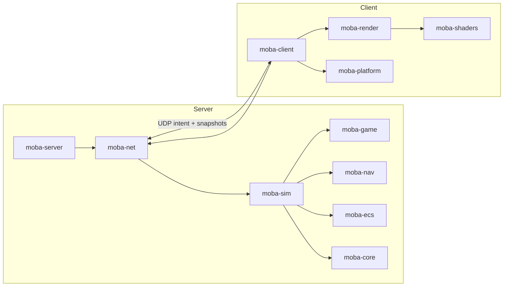

# MOBA Engine

[](https://github.com/JakeGT/moba-engine/actions/workflows/ci.yml)
[](https://github.com/JakeGT/moba-engine/issues)

A server-authoritative multiplayer MOBA engine written in Rust and Vulkan.

> **Status: preview (0.1).** The engine is playable end-to-end — dedicated server, UDP
> netcode, deterministic simulation, Vulkan client with HUD and fog of war — but the public
> API is pre-1.0 and content packs are validated runtime TOML. See [API stability](docs/API-STABILITY.md).


[See the full screenshot gallery](docs/screenshots.md) for the renderer, HUD, fog-of-war,
spectator camera, status effects and runtime-content examples.

## What is in the box

| Area | Capability |
|---|---|
| Simulation | Deterministic 30 Hz 5v5 MOBA, three lanes, towers/nexus, 5 heroes × 3 abilities, minions, bots, respawns, levels/XP, gold, items and a shop |
| Networking | Custom UDP protocol: handshake, intent input, fragmentation, server-authoritative delta snapshots, visibility filtering, local-hero prediction, remote interpolation and a lossy-link conditioner |
| Client | Vulkan 1.2 renderer with instanced units, wall LOS/fog, bitmap HUD with FPS/frame timing, paginated shop, Tab scoreboard, controls and free-pan spectator camera |
| Server | Headless authoritative runner; bots fill empty slots; bandwidth and tick statistics |
| Quality | Fixed-point determinism tests, ECS/job benchmarks, Miri, layered architecture, 216 tests, wire fuzzing and a 5-minute 10-client soak |

## Quick start

Requirements: Rust 1.85+, a Vulkan 1.2 driver, and `glslc` (Vulkan SDK or
`glslang-tools`) to build shaders. Linux, Windows and macOS (MoltenVK) are supported.

```bash
# 1. Headless match (no GPU required)
cargo run --release -p moba-server -- --ticks 20000

# 2. Dedicated server + playable client
cargo run -p moba-server -- --listen 127.0.0.1:7777 --seconds 600
MOBA_SERVER=127.0.0.1:7777 cargo run -p moba-client
```

Or run a self-contained loopback match (spawns a local server inside the client):

```bash
MOBA_SERVER=local cargo run -p moba-client
```

**Controls:** right-click move, left-click attack, Q/W/E cast at the cursor, Space stop,
R ready up in the lobby, F5 surrender vote, B shop (click/1–8 buy, hover tooltip, Left/Right page), hover Q/W/E for details, click minimap to move, Tab scoreboard,
Escape quit. `MOBA_SPECTATE=1` joins read-only with full-map visibility; WASD pans, arrows
rotate/zoom the spectator camera.

Matches run a lobby → 3-second countdown → gameplay → results → automatic rematch loop.
Disconnected players keep their slot for a 60-second grace period while a bot covers, and can
resume with `NetClient::connect_with_session(server, timeout, session)` using
`NetClient::session()`. The dedicated server exposes `--countdown S` and `--results S`.

### Runtime content packs

Servers can load validated TOML item, hero, ability and map definitions and publish them to clients in the handshake:

```bash
cargo run -p moba-server -- --listen 127.0.0.1:7777 --seconds 600 --items content/items.toml
MOBA_SERVER=127.0.0.1:7777 cargo run -p moba-client
```

Packs carry `name`/`version`/`author` metadata; replays record the pack identity alongside the
content hash. The client shop/HUD, cooldowns, range/radius overlays, vision and minimap use the received complete catalogue, verified against `GameContent::hash`; simulation purchases, hero stats, ability effects and map geometry use the same definitions.

`--reload-content` watches the pack and reloads it when the lobby has no connected clients
(connected clients keep their handshake catalogue until they reconnect).
Names are 1–16 ASCII bytes, costs must be positive, packs hold at most 16 items, 8 heroes, 24 abilities, 4 lanes and 32 structures, and hero ability slots reference
catalogue ids. See
[content/example-pack.toml](content/example-pack.toml) and [content/ability-pack.toml](content/ability-pack.toml) and [content/map-pack.toml](content/map-pack.toml) and
[content authoring](docs/content-authoring.md).

### Server configuration

Dedicated servers can be configured with TOML; CLI flags override file values:

```bash
cargo run -p moba-server -- --config server.example.toml
```

See [server.example.toml](server.example.toml) for listen/duration, ready, rate-limit,
content, replay and secret/identity paths.

### Server hardening

The dedicated server enforces a per-address UDP budget (default 120 packets/s, burst 120)
before decoding; raise/lower with `--max-pps N` or disable with `0`. Ctrl-C/SIGINT requests a graceful shutdown and flushes an in-progress replay.
`--results-log matches.jsonl` appends one JSON record per completed match (seed, ticks,
score, content/state hashes and replay path). A global budget (`--max-total-pps`, default
2000) caps distributed/spoofed-source floods. It
reports drop counts plus average/max simulation tick time in its final stats. Rate limiting is application-layer
defence; put public servers behind a DDoS/connection gateway as well.

### Encrypted private servers

Generate a 32-byte key and pass the same 64-hex secret to both sides:

```bash
SECRET=$(openssl rand -hex 32)
cargo run -p moba-server -- --listen 127.0.0.1:7777 --seconds 600 --secret "$SECRET"
MOBA_SECRET="$SECRET" cargo run -p moba-client
```

This enables the authenticated ChaCha20-Poly1305 session mode; see [SECURITY.md](SECURITY.md)
for its scope and limitations.

For per-player access, the server accepts a key ring (`--allow-token HEX`, repeatable; or
`client_tokens` in the TOML config). Each client uses its own token via `MOBA_SECRET`; tokens
authenticate the Hello, derive that player's encryption key, and can be revoked by removing
them from the ring and restarting.

Servers can require **client Ed25519 identities** with
`--allow-client-key <public key>` (repeatable) / `client_identity_keys` in TOML. Clients set
`MOBA_CLIENT_IDENTITY=<seed hex>` and answer a per-connection server challenge; unlisted or
missing keys are rejected.

Servers can also present a pinned Ed25519 identity. Generate a seed, start the server, and pin
the printed public key:

```bash
openssl rand -hex 32 > server.seed
cargo run -p moba-server -- --listen 0.0.0.0:7777 --seconds 600 --server-key server.seed
# prints identity=<64 hex>; clients pin it with:
MOBA_SERVER_PUBKEY=<64 hex> cargo run -p moba-client
```

A pinned client rejects an unsigned or wrongly-signed Welcome; unpinned clients remain
compatible.

Validate content and run the deterministic match harness:

```bash
cargo run -p moba-tools --bin content-check -- content/example-pack.toml
cargo run --release -p moba-tools --bin match-soak -- --matches 50
```

`match-soak` rotates team compositions, replays each seeded bot match twice, checks
determinism and reports tick timing and outcome distribution (`--fixed-picks` for one comp).

Deterministic replays can be recorded by the server and verified offline:

```bash
cargo run -p moba-server -- --listen 127.0.0.1:7777 --seconds 600 --ready --record match.mbr
cargo run -p moba-tools --bin replay -- match.mbr
# custom content pack used by the match:
cargo run -p moba-tools --bin replay -- --items content/example-pack.toml match.mbr
```

Replays store the seed/config, content manifest, exact per-tick inputs and periodic state
checkpoints; the verifier reports the first divergent tick and reproduces the final state
hash. Useful client variables: `MOBA_CAPTURE=frame.ppm`, `MOBA_CAPTURE_FRAME=N`,
`MOBA_SMOKE_FRAMES=N`, `MOBA_VULKAN_VALIDATION=required|off`, `MOBA_DEMO_MOVE=x,y`,
`MOBA_DEMO_BUY=<item>`, `MOBA_SHOP=1`.

## Architecture



The server and simulation never depend on rendering, windowing, `ash` or `winit`; CI
enforces the layering. `moba-core` and `moba-ecs` are the reusable foundation; `moba-game`
and `moba-sim` are content/game rules; `moba-net` is transport + protocol; `moba-render`
and `moba-platform` are presentation.

Read [docs/architecture.md](docs/architecture.md) for data flow, determinism, netcode and
the extension points.

## Workspace

| Crate | Role |
|---|---|
| `moba-engine` | Umbrella entry point with `sim`, `net` and optional `render` features |
| `moba-core` | Q32.32 fixed-point math, RNG, arenas, bitsets, time, hashing |
| `moba-ecs` | Generational SoA archetype ECS, change ticks, item/chunk queries |
| `moba-jobs` | Scoped work-stealing job pool |
| `moba-game` | Data tables and pure rules: heroes, abilities, units, map, items, progression |
| `moba-sim` | Deterministic authoritative simulation |
| `moba-nav` | Spatial grid |
| `moba-net` | UDP transport (optional PSK AEAD), protocol, reconnect, prediction, snapshots and content catalogue |
| `moba-netsim` | Link conditioner for tests |
| `moba-platform` | winit window/input/fixed step |
| `moba-render` | Vulkan renderer, terrain, fog, HUD batch |
| `moba-shaders` | GLSL → validated SPIR-V |
| `moba-server` | Dedicated server binary |
| `moba-client` | Playable client binary |
| `moba-tools` | Soak tester, wire fuzzer and replay verifier |

## Embedding

Add the umbrella crate for a headless tool/server:

```toml
moba-engine = { version = "0.1", default-features = false, features = ["sim", "net"] }
```

or take individual crates (`moba-sim`, `moba-net`, …) for a narrower dependency graph.
Runnable examples live in `crates/engine/examples`:

```bash
cargo run -p moba-engine --example headless_match
cargo run -p moba-engine --example custom_content
```

More embedding patterns (custom ECS systems, content, server hosting, replays) are in
[docs/building-on-moba.md](docs/building-on-moba.md).

## Extending

- **Content:** runtime TOML packs define items, heroes, abilities, growth, lanes, structures
  and vision walls; validated packs are hashed and exchanged in the handshake. See
  [docs/content-authoring.md](docs/content-authoring.md) and the example packs in
  [`content/`](content/).
- **Rules/simulation:** depend on `moba-sim` and drive it from a custom server or tool. The
  simulation consumes intent only and never reads a clock or a hash map. `world()`/`world_mut()`
  expose the ECS for custom components, inspectors and alternate modes.
- **Presentation:** replace `moba-render`/`moba-platform` with another renderer; the
  simulation and netcode are independent.
- **Transport/protocol:** `moba-net` is versioned and field-masked; transport, snapshot model
  and prediction are separate modules.

## Quality gates

```bash
cargo fmt --all --check
cargo clippy --workspace --all-targets --locked -- -D warnings
cargo test --workspace --locked
cargo doc --workspace --no-deps
just soak          # five-minute 10-client lossy soak
just fuzz-wire     # one-hour deterministic wire fuzzing
```

See [CONTRIBUTING.md](CONTRIBUTING.md) for the full workflow, layering rules and review
expectations. Agent-facing development instructions are in [AGENTS.md](AGENTS.md); unfinished
work is tracked in [GitHub Issues](https://github.com/JakeGT/moba-engine/issues).

## Security

Plaintext is the default for LAN development. Optional pre-shared-key mode authenticates the
handshake and encrypts packet payloads (ChaCha20-Poly1305 + HKDF + HMAC). It is not a full
public-internet identity/anti-DoS solution; read [SECURITY.md](SECURITY.md).

## License

Dual-licensed under either of [Apache-2.0](LICENSE-APACHE) or [MIT](LICENSE-MIT), at your
option. Contributions are accepted under the same terms.
