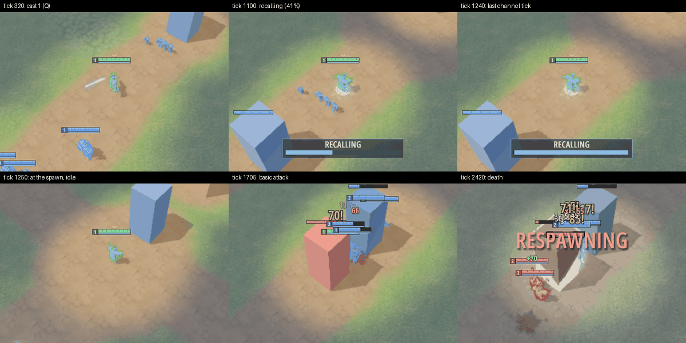

# Recall: the R4 exit run at 150 ms RTT (protocol v42, logic v9)

Captured 2026-10-30 on the development workstation, not a CI runner, for the recall
amendment of [ADR-0012](../adr/0012-animation-runtime.md#amendment-recall-r4-exit-protocol-v42-simulation-logic-v9).

- Renderer: lavapipe (`llvmpipe`) from `/home/jaket/Projects/MOBA/.tools` with the bundled
  Khronos validation layer, `MOBA_VULKAN_VALIDATION=required`. No hardware GPU was used.
- CPU: AMD Ryzen 7 9800X3D; OS: Linux 7.3.0-2-cachyos, Wayland
- Build: release, this branch (based on `main` at `197857b`)

## What the roadmap asks
R4's exit: "a hero with idle, run, attack, three casts, death **and recall** plays correctly in a
networked match at 150 ms RTT". R4b ([perf/0018](0018-vat-anim-lod.md#exit-run-150-ms-rtt))
met everything but recall, which did not exist in the simulation. Recall now does (8 s
channel, `rules.recall_ticks`; cancelled by orders, casts, damage, stun and death; see the
`Simulation` docs), so this run repeats the exit with it.

## Setup
A real server with nine bot heroes, a link proxy at 150 ms RTT, 30 ms jitter and 5 % loss,
and one **player** client (blue slot 0, the skinned `sentinel-skinned` hero for every slot)
through the proxy. The player's orders are scripted with `MOBA_DEMO_ORDERS` (sent at the
first snapshot at or after each tick, so they travel the lossy link like a human's clicks):

```bash
moba-server --listen 127.0.0.1:18977 --seconds 150 --countdown 1
link-proxy --upstream 127.0.0.1:18977 --listen 127.0.0.1:18978 \
  --rtt 150 --jitter 30 --loss 5 --seconds 170
MOBA_SERVER=127.0.0.1:18978 MOBA_HERO_MODELS=sentinel-skinned MOBA_QUALITY=low \
  MOBA_WINDOW_SIZE=960x540 MOBA_VULKAN_VALIDATION=required MOBA_ANIM_LOG=anim.log \
  MOBA_WARMUP_TICKS=2700 MOBA_SMOKE_FRAMES=10 \
  MOBA_CAPTURE_SERIES=frame MOBA_CAPTURE_SERIES_TICKS=320,1100,1240,1250,1705,2420 \
  MOBA_DEMO_ORDERS="move:100:128@30,q@300,w@330,e@360,recall@600,move:70:128@640,\
recall@900,stop@960,recall@1000,move:129:128@1300,attack@1700,recall@1760,attack@1800,\
attack@1900,attack@2000" \
  moba-client      # plus the lavapipe VK_ICD_FILENAMES / VK_LAYER_PATH / LD_LIBRARY_PATH
```

The proxy forwarded 5,392 packets and dropped 246 (4.6 %); the server ran 2,714 ticks. The
client exited cleanly with no validation message.

## The player's hero
`MOBA_ANIM_LOG` records each animated hero's action state and locomotion clip by render tick
(the interpolated view, about four ticks behind the newest snapshot); `[recall]` lines are
the recall events the client received, stamped with the newest snapshot tick then.

| Tick | Order sent | Server event received | Animation (render tick) |
|---:|---|---|---|
| 0 | — | — | idle at the spawn |
| 30 | move to (100, 128) | — | run from 38, idle at 245 |
| 300 / 330 / 360 | Q / W / E at the hero's feet | (casts) | `cast1` 303 (also while running at 307), `cast2` 332, `cast3` 363 |
| 600 | recall | started at (100, 128), tick 606 | `recall` loop from 608 |
| 640 | move to (70, 128) | **cancelled**, tick 645 (an obeyed move) | the loop fades out under the run from 646; idle at 775 |
| 900 | recall | started, tick 906 | `recall` from 908 |
| 960 | stop | **cancelled**, tick 966 (stop) | idle from 973 |
| 1000 | recall | started, tick 1005 | `recall` from 1007 |
| — | — | *completion lost (5 % loss)* | the recall flag cleared: idle from 1252, at the spawn (52, 128) |
| 1300 | move to (129, 128) beside the red tower | — | run from 1308, idle at 1638 |
| 1700 | attack the nearest enemy | — | `attack` at 1703 and 1729 |
| 1760 | recall | started, tick 1764 | `recall` from 1767 |
| 1800 | attack | **cancelled**, tick 1805 (an order) | idle from 1813 |
| — | — | (killed under the tower) | dead flag at 2405, `death` at 2410 |
| — | — | (respawned) | idle at 2705 |

So one skinned hero played idle, run, attack, three casts, death and recall — started three
ways, cancelled by a move, a stop and an attack order, and completed — over a 150 ms / 30 ms /
5 % link. The completed recall shows both protections working:

- **Teleport snap.** The hero went from (70, 128) to the spawn (52, 128), 18 units, in one
  tick. The view held it at the channel spot until that snapshot's tick and then drew it at
  the spawn: no slide, and no run or turn on arrival (the log goes straight from `recall` to
  idle; before the fix in this change a 16-unit threshold missed this 18-unit recall and the
  log showed a one-frame `run` there).
- **Lost events.** In this run the completion event was one of the dropped packets'. The
  recall flag cleared in the next snapshot and ended the loop on the same tick an event
  would have. Two earlier runs with the same orders received it (`completed at (70.0, 128.0)
  -> (52.0, 128.0)`, tick 1244 and 1245) and logged the same animation ticks within a tick.



*Crops of the capture series (960×540 logical, Low): cast 1; recalling at 41 % with the HUD
channel bar and the recall effect's ring and light at the feet; the last channel tick; idle
at the spawn one tick after arrival; a basic attack beside the red tower; the death.*

## The other nine heroes
Over the same run the nine bot heroes logged 523 `attack`, 60 `cast1`, 17 `cast2`, 26 `cast3`
and 6 `death` transitions (the player's hero: 2, 2, 1, 1, 1 and 5 `recall`). Bots do not
recall, so no other recall event reached the client.

## Fog of war
A client is told about an enemy's recall only while it sees that hero: the recall flag is
part of the entity (filtered with it), a start or cancel needs the hero in the viewer's
vision in that tick, and a completion also goes to viewers who saw it in their previous
snapshot, because the hero teleports out of their vision in the tick it completes. Tests in
`crates/net/src/server/tests.rs`:

- `an_enemy_recall_out_of_vision_is_never_reported`: a red hero recalls deep in its own
  half for the whole 8 s; blue's client gets no event, no flagged snapshot and never even a
  net id for it.
- `a_visible_enemy_recall_is_reported_from_start_to_completion`: one beside blue's hero is
  flagged in 239 of the 240 channel snapshots (not the arrival's) and reported as started
  (`aux` 240) and completed (`x2`/`y2` = red's spawn), after which it is out of vision.
- `recall_start_and_cancel_need_the_hero_in_view`: the filter rules above.

## Bandwidth
Recall costs nothing unless someone recalls: the flag is a spare bit of the existing entity
flags byte, and `EVENT_RECALL` is one 26-byte event per edge (at most three per recall). The
`soak` runs of [perf/0009](0009-presentation-events.md#protocol-v41-basic-attack-events) are
unchanged, since bots do not recall.

## Reproduce
The server and proxy commands above, then the client with the environment shown. Two runs
with the same orders received the same recall edges within a tick; the animation log differs
only where packet loss moved a snapshot's arrival.
