# Screenshots

Captures from the Linux client with headless readback (PPM/PNG). Most were taken under Mesa
lavapipe; the renderer captures in M3 were taken with validation required. UI and art are
preview-quality and will evolve.

## Renderer and simulation

### Animated hero rig


Local preview with procedural multi-part hero rigs (torso/head/arms/legs) animated from the
deterministic simulation tick; minions and structures retain the instanced-cube path.

### Real NVIDIA hardware (1920×1080)


Local bot preview after 3,000 warmup ticks on an RTX 5070 Ti with validation required; frame log
p95 4.197 ms / max 4.538 ms with vsync off.

### GPU particle VFX (R5)
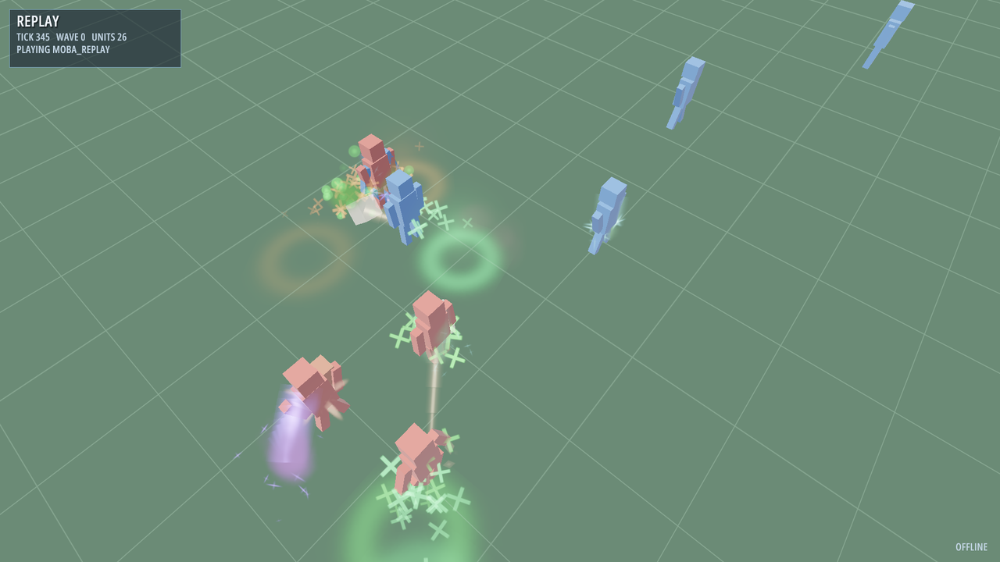

The checked-in scripted teamfight (`tests/replays/teamfight-5v5.mbr`) played in the local view
with every effect of `content/vfx/` ([ADR-0013](adr/0013-vfx-runtime.md)) at tick 345, RTX
5070 Ti, High, 1920×1080 (shown at 1280×720), camera 20 m, validation and sync validation
required, zero messages. Heals (green rings and crosses), an Arc Bolt in flight, a Venom Dart
trail, a Cleaving Throw blade (a mesh particle), hit sparks and a dash smoke trail (purple,
alpha-blended through weighted blended OIT). The local HUD titles replay playback `REPLAY`
(and the preview below `VFX PREVIEW`).

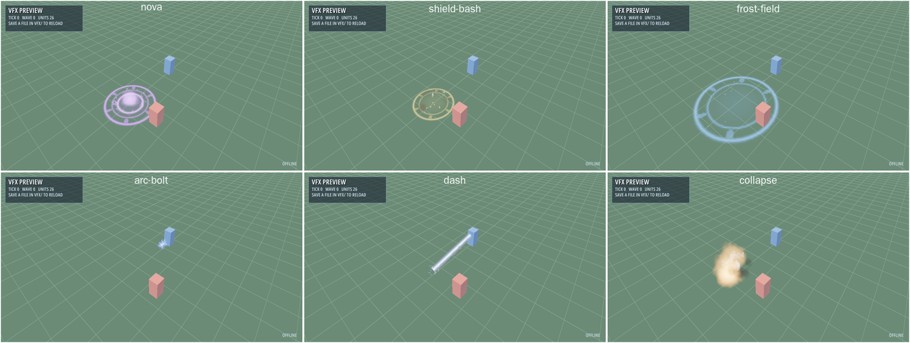

`MOBA_VFX_PREVIEW=<effect>` (the authoring loop; lavapipe, validation required): one sample
effect per tile at 0.2 s, played at a stand-in target (red) from a stand-in caster (blue). The
preview reloads within half a second when a file in `content/vfx/` changes.

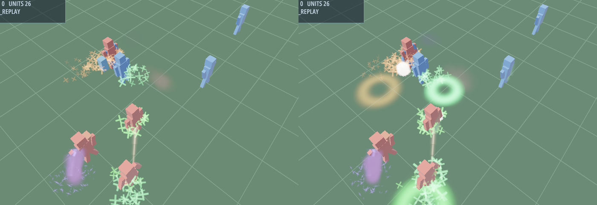

The same replay frame (tick 345, cropped) on Low (left: unsorted alpha, no soft particles, no
mesh particles, the packed HDR target) and High (right), lavapipe with validation required,
`MOBA_VFX_SCALE=8`. At eight times the authored emission Low's smaller budgets (4,096
particles, 1.5 screens of overdraw) already drop new spawns by importance — an orange heal
ring and some sparks are missing — while High draws everything.

```bash
MOBA_REPLAY=tests/replays/teamfight-5v5.mbr MOBA_WARMUP_TICKS=<tick> MOBA_CAMERA_DISTANCE=30 \
MOBA_CAPTURE=/tmp/vfx.ppm MOBA_CAPTURE_FRAME=30 MOBA_SMOKE_FRAMES=40 cargo run --release -p moba-client
MOBA_VFX_PREVIEW=nova MOBA_CAPTURE=/tmp/nova.ppm MOBA_CAPTURE_FRAME=6 cargo run --release -p moba-client
```

### Post-processing tiers (R6)
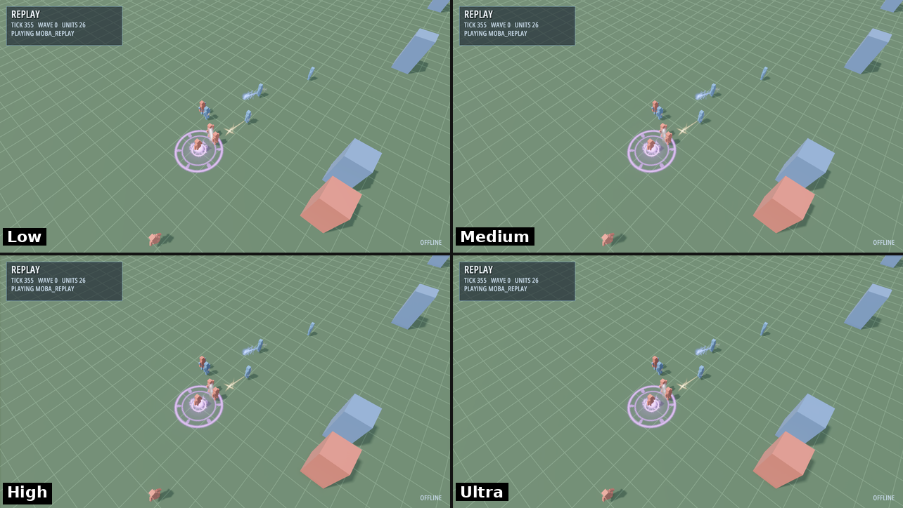

The scripted teamfight replay at tick 355 on each tier's post defaults
([ADR-0015](adr/0015-post-processing.md)), lavapipe at 1280×720 (shown at half size),
validation and sync validation required, zero messages. Low: FXAA (fast preset), no bloom,
dynamic resolution pinned for the capture; Medium: + bloom; High: + half-resolution GTAO;
Ultra: MSAA 4× and 3-slice GTAO. The HUD is identical on every tier: it is drawn after the
post chain at native resolution.

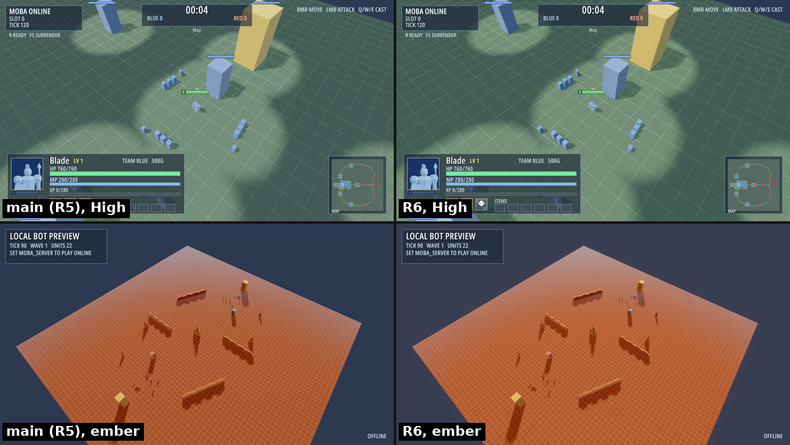

`main` at R5 (left) against R6 (right) on High: the networked golden frame (tick 120) and the
ember map. R6 adds the map's colour grade (`meadow`, `ember`), bloom, FXAA and GTAO; the
lighting, team colours and HUD are unchanged.

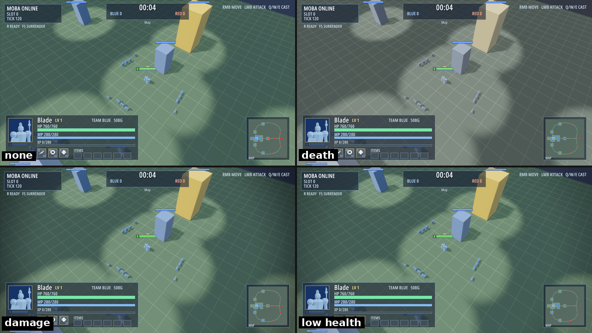

The three gameplay effects held for a capture with `MOBA_SCREEN_EFFECTS_PREVIEW`: none, death
desaturation (capped at 0.6, so the teams stay distinguishable), the damage vignette at its
peak and the low-health pulse at its peak (a neutral dark in the outer corners only, never a
team hue). Captured after the #334 review fixes. Each has
its own setting (`death_desaturation`, `damage_vignette`, `low_health_pulse`) and
`MOBA_SCREEN_EFFECTS=off` turns all three off; the HUD is never affected.

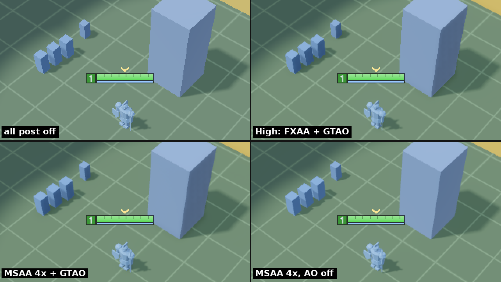

A 320×180 crop of the networked frame at 2× (nearest): every post feature off, High (FXAA +
GTAO), High with `MOBA_AA=msaa4`, and Ultra with `MOBA_AO=off`. FXAA softens the tower and
minion edges; MSAA resolves them geometrically; GTAO adds the contact darkening at the bases
of the tower and the minions.

The blind A/B readability set (`images/r6-ab-1.png` … `r6-ab-6.png`, `main` against R6 with
shuffled sides) and its protocol are in [perf/0019](perf/0019-post.md#blind-ab-readability-check).

```bash
MOBA_REPLAY=tests/replays/teamfight-5v5.mbr MOBA_WARMUP_TICKS=345 MOBA_QUALITY=<tier> \
MOBA_CAPTURE=/tmp/r6.ppm MOBA_CAPTURE_FRAME=10 MOBA_SMOKE_FRAMES=12 cargo run --release -p moba-client
MOBA_SERVER=local MOBA_HERO_MODELS=sentinel-skinned MOBA_CAPTURE_TICK=120 MOBA_SMOKE_FRAMES=100000 \
MOBA_SCREEN_EFFECTS_PREVIEW=death MOBA_CAPTURE=/tmp/r6-death.ppm cargo run --release -p moba-client

### Terrain, fog of war v2 and atmosphere (R3a)
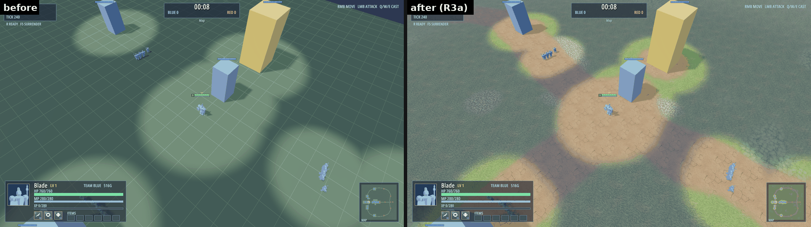

The networked gameplay camera at tick 240 (`MOBA_SERVER=local`, skinned heroes), RTX 5070 Ti,
High, 1920×1080 (shown at half size), validation and sync validation required, zero
messages ([ADR-0014](adr/0014-terrain-fog-of-war.md), [perf/0017](perf/0017-terrain-fow.md)).
Before: the flat grid plane and the 16-circle fog of war. After: the generated splat terrain
(grass, dirt paths along the lanes and around structures, pebble patches), the fog-of-war
texture from the blue team's vision (darkened, desaturated and misted outside it, soft edges)
and height fog.

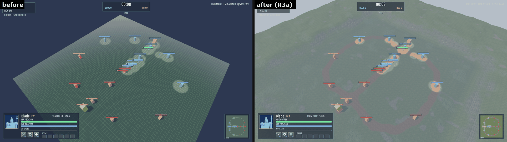

`MOBA_CAMERA=overview`: the board reads as a basin, with the hills of the terrain margin
rising past the edge and fading into the sky; every allied tower, minion and hero lights its
own patch of the map (no 16-source cap). The minimap (bottom right) is masked by the same
texture.

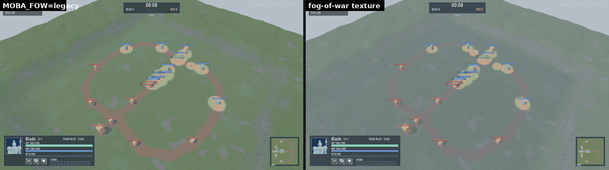

The same overview with `MOBA_FOW=legacy` (left: the pre-R3a circle loop over the new terrain, a
fixed darkening with no map styling and at most 16 sources) and the fog-of-war texture (right).

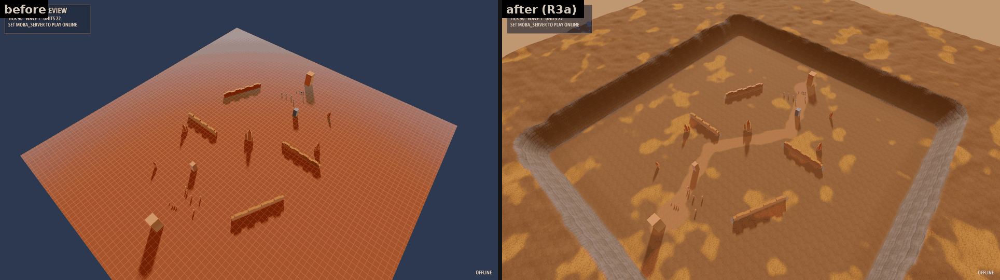
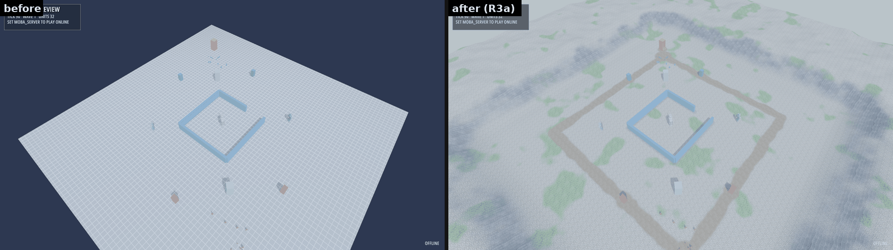

The ember and frost sample maps in the local preview (`MOBA_CONTENT=content/ember-map.toml`,
`content/frost-map.toml`): ember's terraced cliffs and basalt layers, frost's snow drifts and
denser haze. Their `[terrain]`, `[atmosphere]` and `[fog_of_war]` tables are in
[`content/maps/`](../content/maps/).

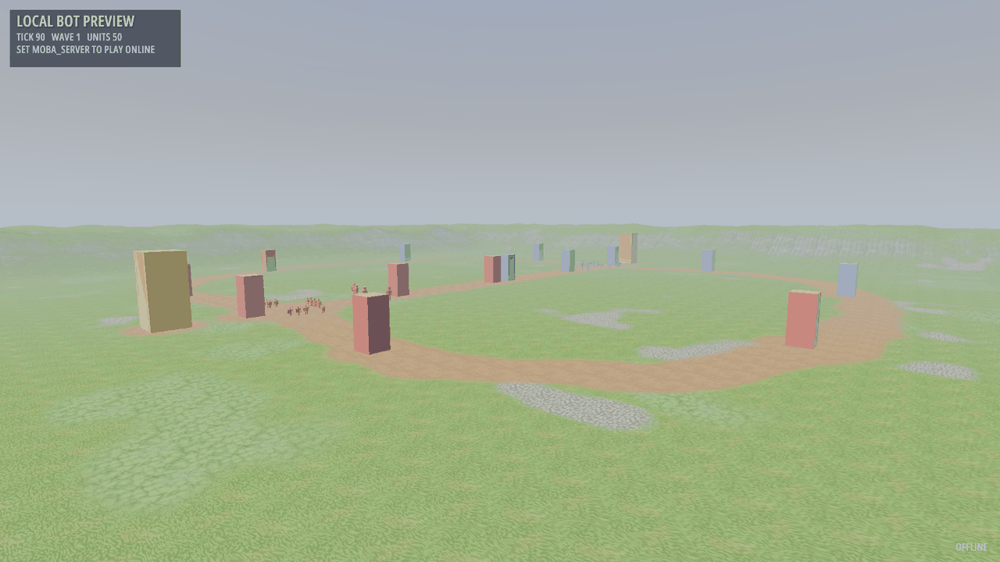

`MOBA_PREVIEW_CAMERA=-0.7,0.12,170` (the horizon golden's camera): the environment sky, the
haze towards the horizon and the map-edge hills, with no board edge in sight.

```bash
MOBA_SERVER=local MOBA_HERO_MODELS=sentinel-skinned MOBA_CAPTURE_TICK=240 MOBA_SMOKE_FRAMES=100000 \
  MOBA_CAMERA=overview MOBA_CAPTURE=/tmp/overview.ppm cargo run --release -p moba-client
MOBA_PREVIEW_CAMERA=-0.7,0.12,170 MOBA_CAPTURE=/tmp/horizon.ppm MOBA_CAPTURE_FRAME=90 \
  MOBA_SMOKE_FRAMES=120 cargo run --release -p moba-client
```

### VAT minions, attachments and the 150 ms RTT run (R4b)
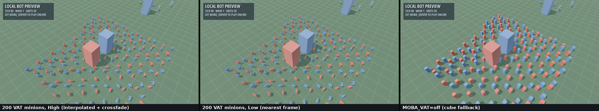

`MOBA_STRESS_MINIONS=200` in the local bot preview at tick 90, camera 40 m, RTX 5070 Ti,
1280×720, validation and sync validation required, zero messages
([perf/0018](perf/0018-vat-anim-lod.md)). Half the stress minions run in circles and half
attack on the spot, each with its own `VatPlayer`, drawn instanced from
`content/vat/minion.{toml,ktx2}` with no bone buffer and casting shadows. Left: High
(interpolated frames, crossfades); middle: Low (nearest frame); right: `MOBA_VAT=off`, the
cube every minion drew before R4b.

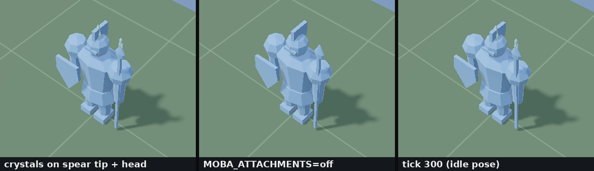

The networked golden configuration (`MOBA_SERVER=local`, `MOBA_HERO_MODELS=sentinel-skinned`,
pinned `MOBA_CAPTURE_TICK`) with `MOBA_CAMERA_DISTANCE=12`, cropped around the own hero and
scaled 1.5×: the `crystal` attachments on the `spear_tip` and `head` sockets
(`content/animations/sentinel-skinned.toml`), the same frame with `MOBA_ATTACHMENTS=off`, and
tick 300.

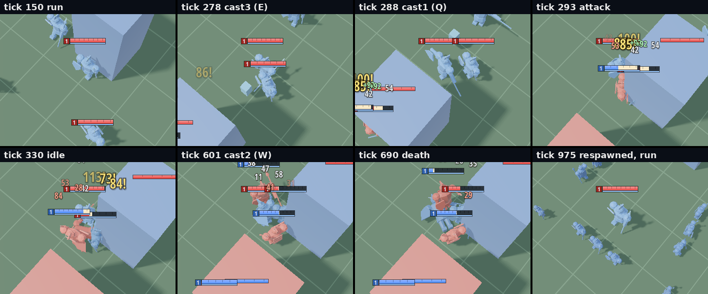

The R4 exit run: `moba-server` with 10 bots, a spectator client following blue slot 0 through
`moba-tools link-proxy --rtt 150 --jitter 30 --loss 5` (RTX 5070 Ti). Captures at the render
ticks where the hero's animation log (`MOBA_ANIM_LOG`) shows run, cast 3, cast 1, a basic
attack, idle, cast 2, death and the respawned run. The simulation has no recall.

```bash
MOBA_STRESS_MINIONS=200 MOBA_LOCAL_CAMERA_DISTANCE=40 MOBA_CAPTURE=/tmp/stress.ppm \
  MOBA_CAPTURE_FRAME=90 MOBA_SMOKE_FRAMES=120 cargo run --release -p moba-client
MOBA_SERVER=local MOBA_HERO_MODELS=sentinel-skinned MOBA_CAPTURE_TICK=120 MOBA_CAMERA_DISTANCE=12 \
  MOBA_SMOKE_FRAMES=100000 MOBA_CAPTURE=/tmp/attach.ppm cargo run --release -p moba-client
```

### 500 instanced units + terrain


Renderer stress capture at 1920×1080: instanced units, terrain grid, team colours and clear
colour. Validation produced zero messages.

### Simulation slice


Headless-produced match rendered by the client, showing lanes, structures, heroes and
projectiles.

## Networked client and HUD

### Networked client


Client connected over UDP with predicted local hero and interpolated remote units.

### HUD and fog of war


Health/mana/XP, ability cooldowns, items, timer and team score, with terrain fog of war.

### Countdown


Lobby-to-match countdown, ready state and roster.

### Minimap and floating health bars


Minimap with lanes and team dots, plus world-space health bars.

### Scoreboard


Tab scoreboard with both teams, levels and health.

### Shop


Runtime item catalogue, costs and affordability; the live shop supports arrow-key paging for
packs with more than eight items.

### Progression


XP, gold, level and purchased item state after combat.

### Ready lobby


Ready-up gating before the countdown starts.

### Custom map theme (snow ARAM)


The ARAM pack sets `[map] theme = "snow"`; the client selects the built-in snow terrain/wall
palette without recompiling. Captured with `MOBA_CONTENT=content/aram.toml` on lavapipe.

## Vision, status and spectator

### Wall line-of-sight fog


Custom map wall geometry and wall-aware fog: vision circles are clipped where a wall crosses
the source-to-fragment ray.

### Minimap walls and frame diagnostics


Walls rendered on the minimap, the smoothed FPS/frame-time diagnostic, and the full HUD.

### Status icons


Health-bar icons for shield, slow, root, silence, burn and haste; units also receive a
status tint.

### Spectator view


Read-only spectator with both teams visible and no player slot.

### Free-pan spectator camera


Spectator camera panned/zoomed with WASD and arrows; full-map visibility is retained.

## Runtime content

### Custom hero content


Client using a runtime pack's custom Vanguard hero, stats and name.

### Custom map content


One-lane map pack with custom structures/spawns and minimap geometry.

### Custom hero model (.glb)


Local networked match (`MOBA_SERVER=local`) with the shipped `content/models/sentinel.glb`
loaded from the client-local asset root and drawn through `Renderer::register_mesh` and the
per-mesh instanced draw (ADR-0007). Minions and structures stay on the cube mesh in the same
frame. Lavapipe, 1280×720, validation and synchronization validation required, zero messages.
The camera is pulled in with `MOBA_CAMERA_DISTANCE=12`:

```bash
MOBA_SERVER=local MOBA_HERO_MODELS=Blade=sentinel,Guardian=sentinel,Mage=sentinel \
MOBA_CAMERA_DISTANCE=12 MOBA_SMOKE_FRAMES=1000 \
MOBA_CAPTURE=/tmp/frame.ppm MOBA_CAPTURE_FRAME=960 \
MOBA_VULKAN_VALIDATION=required cargo run -p moba-client
```

A missing, path-escaping or truncated model logs one `[assets]` line and that hero keeps the
procedural rig.

### Textured material (R1b)


The same networked frame (tick 120, `MOBA_CAPTURE_TICK`) without and with the sample material
`content/materials/sentinel.toml` (ADR-0010): left, `main` at `6e809f0` (vertex colour); right,
this build drawing the static `sentinel.glb` with the `MATERIAL_TEXTURED` permutation, a BC7
base colour, a BC5 normal map and a BC4 team mask (the painted plates take the blue team colour,
the bronze seams and rivets do not). All textures are self-generated (`texture-bake generate
sentinel`). Lavapipe, 1280×720, validation and synchronization validation required, zero
messages; 400×300 crops around the hero. Decoding the BC textures on the CPU instead
(`MOBA_COMPRESSED_TEXTURES=0`) changes no channel by more than one 8-bit step.

```bash
MOBA_SERVER=local MOBA_HERO_MODELS=Blade=sentinel,Guardian=sentinel,Mage=sentinel \
MOBA_CAMERA_DISTANCE=10 MOBA_CAPTURE_TICK=120 MOBA_SMOKE_FRAMES=100000 \
MOBA_CAPTURE=/tmp/frame.ppm MOBA_VULKAN_VALIDATION=required cargo run --release -p moba-client
```

### GPU-skinned hero (walk cycle)


Three captures (frames 400, 404 and 408) of the own hero walking in a local networked match,
drawn with the shipped `content/models/sentinel-skinned.glb` through
`Renderer::register_skinned_mesh` (`skinned.vert`, per-frame bone buffer, push-constant bone
range; WP-4.1, #288). The pose comes from the hero's interpolated movement (gait) and the render
tick: arms, spear and legs counter-swing, the chest twists and the hips bob. Each crop is from a
separate 1280×720 lavapipe run with validation and synchronization validation required: exit 0
and zero validation messages (stderr is only `[assets] model 'sentinel-skinned' loaded
(skinned)`). The default golden scene has no models and is unchanged.

```bash
MOBA_SERVER=local MOBA_HERO_MODELS=sentinel-skinned MOBA_CAMERA_DISTANCE=10 \
MOBA_DEMO_MOVE=200,200 MOBA_SMOKE_FRAMES=420 \
MOBA_CAPTURE=/tmp/frame.ppm MOBA_CAPTURE_FRAME=400 \
MOBA_VULKAN_VALIDATION=required cargo run --release -p moba-client
```

`MOBA_NO_SKINNING=1` draws the same model as a static mesh (stride bob only); a model without
a skin is always static, and a missing model keeps the procedural rig.

### Networked golden: skinned heroes at a pinned tick


This is the frame behind the second render-golden fingerprint,
`tests/golden/render-network-fingerprint.rgb` (WP-4.2, #289).
- **Setup:** an in-process loopback server (`MOBA_SERVER=local`) with GPU-skinned heroes.
- **Capture point:** `MOBA_CAPTURE_TICK=120`. The local server is lock-stepped to the client and
  stops at tick 120, and interpolation and animation are pinned to that tick. The bots' heroes
  walk (bottom of the frame) while the idle local hero stands in its rest pose at the centre.
- **Capture mode:** the HUD leaves out the FPS, ping and packet counters.
- **Repeatable:** two lavapipe runs at 1280×720 with validation and synchronization validation
  required produced byte-identical PPMs, with zero validation messages.

```bash
MOBA_SERVER=local MOBA_HERO_MODELS=sentinel-skinned MOBA_CAPTURE_TICK=120 \
MOBA_SMOKE_FRAMES=100000 MOBA_CAPTURE=/tmp/frame.ppm \
MOBA_VULKAN_VALIDATION=required cargo run --release -p moba-client
```

### HDR target and AgX tonemap (R1a): before and after


The same networked golden frame (tick 120, lavapipe, 1280×720), before and after R1a
([ADR-0008](adr/0008-render-graph.md)).
- **Left:** the old single forward pass straight into the swapchain.
- **Right:** the render graph. The scene renders into an `R16G16B16A16_SFLOAT` target, a
  composite pass applies exposure and AgX with a saturation look, and the HUD is drawn
  afterwards.
- **What changed:** shadows and mid-tones are almost unchanged. Highlights roll off (the lit
  structures are dimmer), and team colours keep their hue. HUD pixels are identical, because the
  UI is never tonemapped.
- **Rebaseline:** this is the deliberate rebaseline of both golden fingerprints. Validation and
  synchronisation validation reported zero messages, and two runs gave identical fingerprints.

### R2a lighting
Stylised PBR, image-based lighting and directional shadows
([ADR-0011](adr/0011-art-style-lighting.md), [perf/0015](perf/0015-lighting.md)). Every
capture below is 1280×720 on lavapipe with validation and synchronisation validation required
(0 messages), halved side by side. **Left:** `main` at `503bbad` (R1b, before R7a's and R7b's HUD work, so
the HUD fonts, portrait and minimap differ; the right-hand networked frame is the R7b-rebased golden). **Right:** this branch at the High tier.

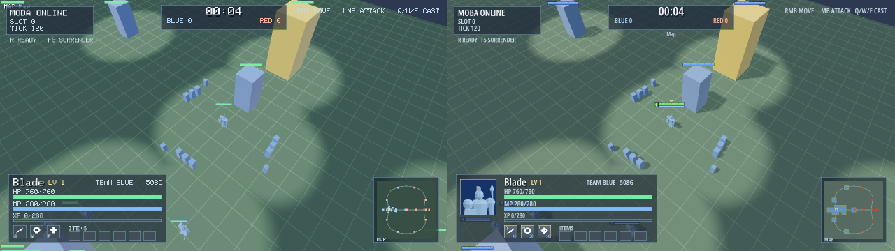

**The networked golden frame** (tick 120, GPU-skinned heroes). The default grass map now has a
descriptor (`content/maps/map-grass.toml`) with the `meadow` environment.
- Every unit — minions, towers, walls and the skinned heroes — casts into one fitted shadow
  map; the tower and minion shadows fall away from the sun (upper right).
- Ambient comes from the environment's SH irradiance instead of the flat hemispheric term,
  and the sides facing away from the sun keep their team colour (`shadow_strength` 0.75 and
  wrap 0.2, readability rules 1–2).
- This is the deliberate rebaseline of both golden fingerprints; two runs gave identical
  fingerprints.

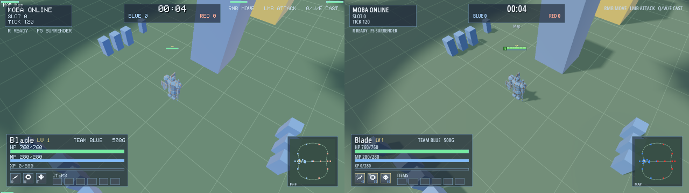

**The textured sentinel** at the 18 m player camera (`MOBA_HERO_MODELS=sentinel
MOBA_CAMERA_DISTANCE=18`). The normal map now uses the vertex tangents written by
`sample-mesh`, roughness comes from the metallic-roughness texture (the bronze trim is
metallic), and the PCSS-lite shadow hardens where the feet touch the ground and softens
towards the head.

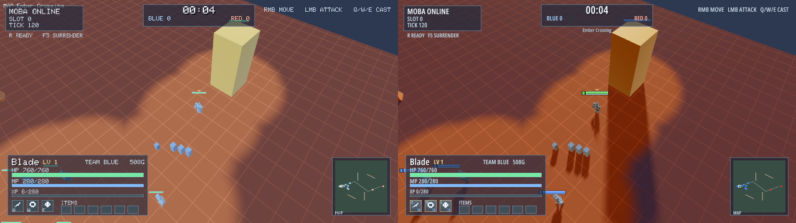

**Map art direction** (`MOBA_CONTENT=content/ember-map.toml`): the ember descriptor's
`[lighting]` table sets a low, warm sun with long shadows, the `ember` environment at reduced
intensity and a warm rim that takes half its hue from each unit's albedo, so blue units stay
blue under an orange sky (ADR-0011 rule 1; the first tuning pass turned them grey and was
reverted).

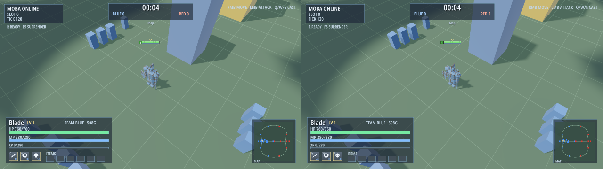

**Tiers:** Low (left: one hard PCF tap at 1024², SH ambient without the specular cube) and
High (right: PCSS-lite at 2048², specular cube), same frame. Low keeps the readability of
High; its shadow edges are harder and slightly aliased.

```bash
MOBA_SERVER=local MOBA_HERO_MODELS=sentinel MOBA_CAMERA_DISTANCE=18 MOBA_CAPTURE_TICK=120 \
MOBA_SMOKE_FRAMES=100000 MOBA_QUALITY=low MOBA_CAPTURE=/tmp/low.ppm \
MOBA_VULKAN_VALIDATION=required cargo run --release -p moba-client
# MOBA_SHADOWS=off|hard|pcf|pcss, MOBA_SHADOW_SIZE=<n>, MOBA_IBL=0 and MOBA_SPECULAR_IBL=0
# turn individual features off or override the tier.
```

### R2b lights, outlines, baked AO and contact shadows
Clustered forward point lights, team outlines, baked map AO and a depth pre-pass with
contact shadows ([ADR-0016](adr/0016-lights-outlines-ao.md),
[perf/0020](perf/0020-lights-outlines-ao.md)). Every capture is 1280×720 on lavapipe with
validation and synchronisation validation required (0 messages). **Before:** `main` at
`74f3087`; **after:** this branch, High tier unless noted.

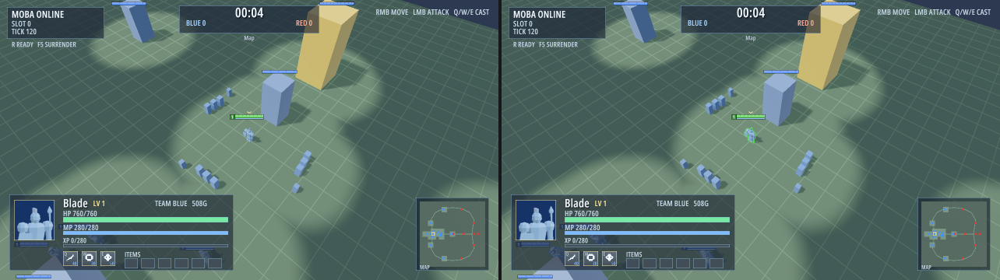

**The networked golden frame** (tick 120, GPU-skinned heroes, halved). The own hero carries
a green screen-space outline (High: dilated from the pre-pass ID target, drawn after the
tonemap so its colour is the HUD palette's exactly) and a small contact shadow under its
feet. Nothing else changes: no effect light is live at tick 120 and the default grass map
has no static occluders, so it has no AO bake. This is the deliberate rebaseline of both
golden fingerprints.

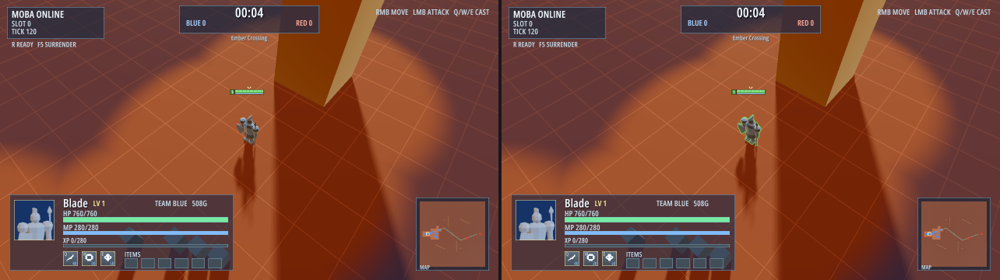

**Ember at a 24 m camera** (`MOBA_CONTENT=content/ember-map.toml MOBA_CAMERA_DISTANCE=24`,
halved): the outline reads against the warm ground the hero's grey albedo blends into.

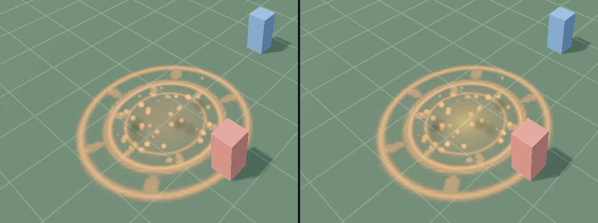
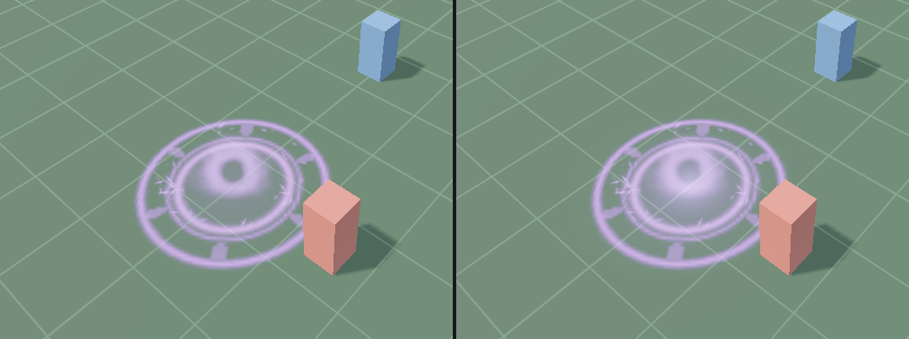

**Effect lights** (`MOBA_VFX_PREVIEW=cinder-zone`, `nova`; full-resolution crops): each
effect's `[light]` block lights the ground and the nearby units in its colour, inside the
windowed radius, so a zone reads as a source of light rather than a decal. The particles
differ between columns only because the preview loop's phase differs.

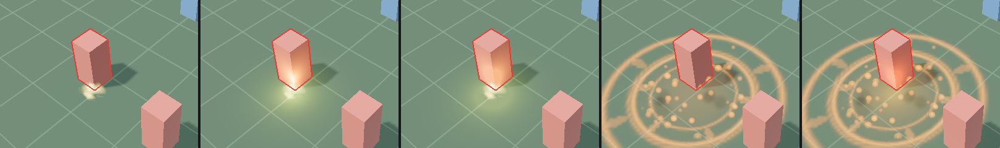

**Readability under effect lights** (`MOBA_VFX_PREVIEW=judgement-hit` frame 3 and
`cinder-zone` frame 20, `MOBA_OUTLINE_PROBE=hit` stands an outlined enemy a metre behind the
light, High, crops): lights off; the review-round-1 falloff (`max(d², 0.25)`, no clamp), with
a near-white hot spot at the unit's base; the shipped falloff (`max(d², 1)`, the summed
irradiance clamped to 1.5× the sun), where the unit brightens but keeps its team colour
(saturation 0.36 off, 0.39 on); the zone with lights off and on, where the telegraph ring
keeps its contrast. [perf/0020](perf/0020-lights-outlines-ao.md) has the numbers.

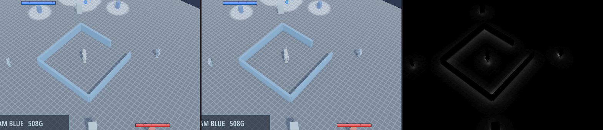

**Baked AO** (`MOBA_CONTENT=content/frost-map.toml MOBA_CAMERA=overview`, crop; left
`MOBA_BAKED_AO=off`, middle on, right the absolute difference ×6): the `ao-bake` map darkens
the ambient where walls and props meet the ground (max delta 22 of 255 on 1.4 % of the
frame). It is deliberately subtle in sunlit areas, where the sun dominates; it is strongest
in shade and on Low, where it stands in for contact shadows.

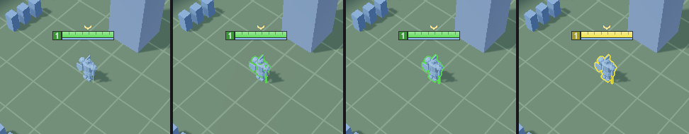

**Outline modes** (networked frame, crops): `main` (no outline), Low (an unlit inverted hull
drawn in the scene pass, before the tonemap), High (screen-space) and High with
`MOBA_TEAM_PALETTE=colorblind`, where the own-hero outline follows the HUD's blue/yellow
palette with the health bar.

```bash
MOBA_SERVER=local MOBA_HERO_MODELS=sentinel-skinned MOBA_CAPTURE_TICK=120 \
MOBA_SMOKE_FRAMES=100000 MOBA_CAPTURE=/tmp/r2b.ppm MOBA_VULKAN_VALIDATION=required \
cargo run --release -p moba-client
# MOBA_LIGHTS=off|<cap>, MOBA_OUTLINES=off|hull|screen, MOBA_BAKED_AO=off and
# MOBA_CONTACT_SHADOWS=off|<steps> turn individual features off or override the tier.
```

### HUD polish (R7a): before and after
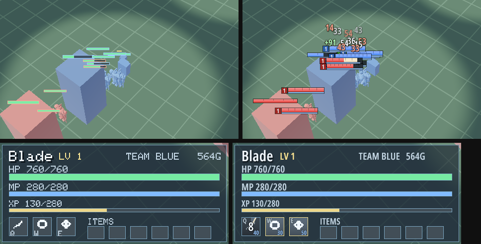

The same networked frame before (left, `main` at `e2972de`) and after R7a (right), cropped from
1280×720 lavapipe captures. The local hero walks into the mid-lane fight
(`MOBA_DEMO_MOVE=118,127`), and the frame is pinned at tick 950.
- **Text:** the 5×7 bitmap font is replaced by an MSDF font (Open Sans Condensed SemiBold)
  with derivative anti-aliasing, outlines and soft shadows. Capitals keep their height, so the
  layout is unchanged.
- **Health bars:** own/ally/enemy fill colours, a cream damage ghost trailing each hit (the red
  bars), tick marks every 100 HP, a level badge and a mana strip for heroes.
- **Combat text:** numbers rise over the fight. Damage to the viewer's team is red and damage
  to enemies white; heals are green with a `+`. They come from snapshot health deltas, so hits
  inside one snapshot interval add up.
- **Ability slots:** Q (cast at tick 930 with `MOBA_DEMO_CAST=0@930`) shows the radial
  cooldown sweep and its remaining seconds. Ready slots have a gold frame and show the mana
  cost.
- The "before" run ignores `MOBA_DEMO_CAST`, which is new, so its Q slot is idle.

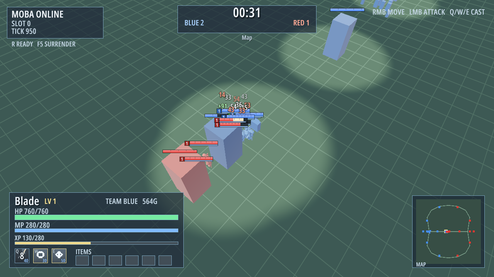

The full "after" frame. The kill feed now sits under the controls line, and the map name under
the timer.

### Crisp text at UI scale 2.0
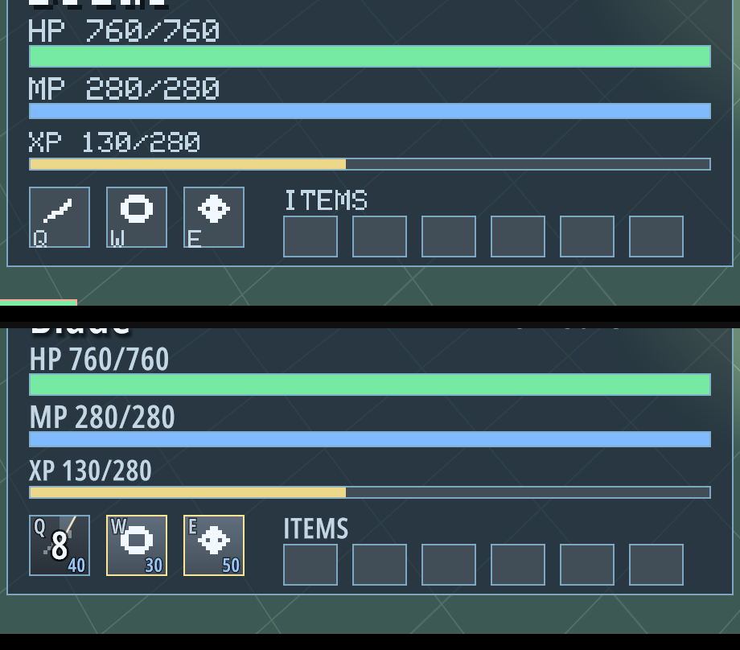

The same frame at 2560×1440 with `MOBA_UI_SCALE=2.0`, cropped at native resolution. Top: the
bitmap font, scaled with nearest filtering, shows its blocky 5×7 cells. Bottom: the MSDF text,
baked at 40 px per em, stays sharp when drawn larger than the atlas (the hero name is about
59 px per em here). Bars and frames are also scaled 2×.

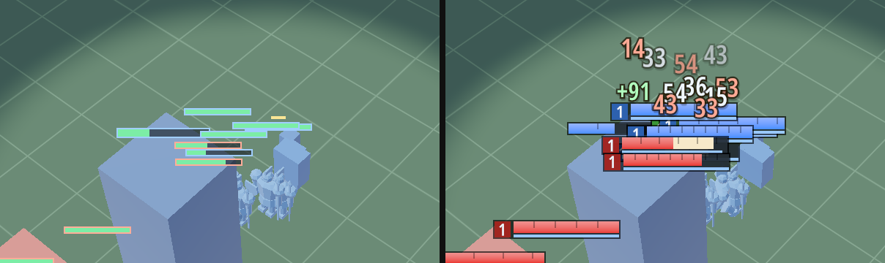

The world-space bars and numbers in the same 2× frames.

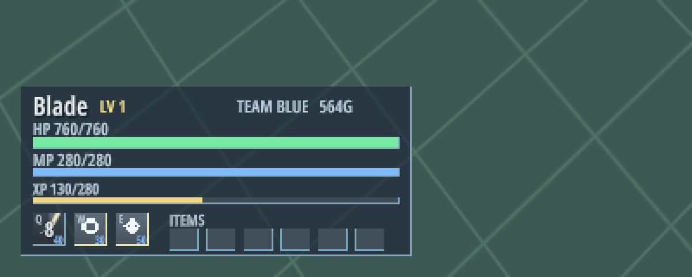

The supported minimum, `MOBA_UI_SCALE=0.5`, at 1280×720, magnified 3× with nearest filtering.
The outlined key labels and mana costs on Q/W/E show no dark glyph boxes. At this size the
on-screen distance range is under one pixel, and the outline fades out over the empty margin of
each glyph cell (reviewer finding, fixed in `ui.frag`).

### Colour-blind team palette
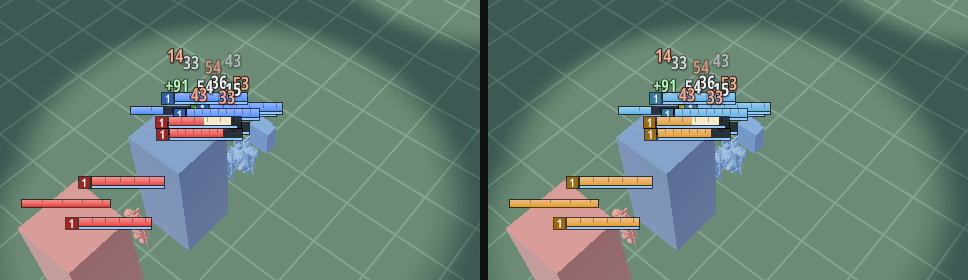

`team_palette = "colorblind"` (or `MOBA_TEAM_PALETTE=colorblind`), right, against the default
`standard`, left. It uses Okabe-Ito colours: yellow for the own hero, sky blue for allies and
orange for enemies, on health bars and the minimap. Allies and enemies then differ mainly on
the blue–yellow axis, which protanopes and deuteranopes can still see.

### Loading screen
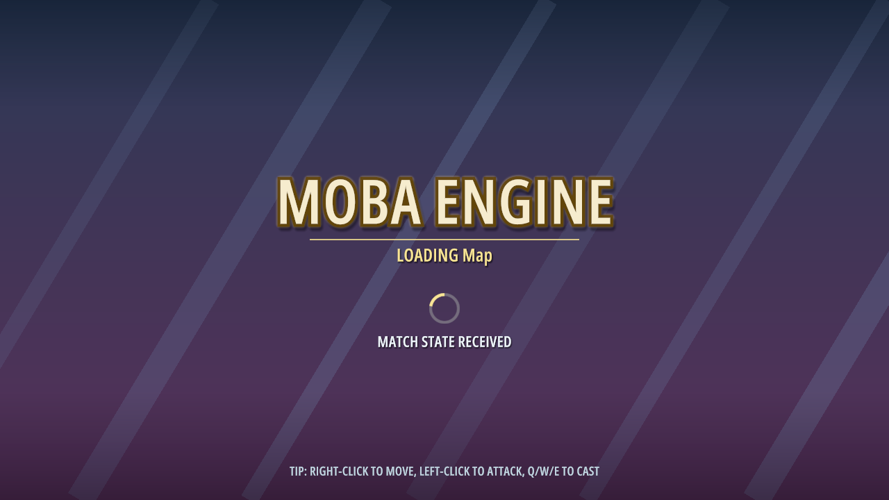

The loading screen is procedural (gradient, light bands, a glowing outlined title, map name,
spinner and tip). It shows for at least 1.2 s after connecting or a map change, then
cross-fades into the lobby. Lobby, match and results screens change with a short dip to dark,
and the lobby and results panels fade and slide in. Captured at frame 3 of a
`MOBA_SERVER=local` run. `MOBA_CAPTURE_TICK` captures, such as the networked golden, settle
all fades and skip the splash.

All R7a captures: lavapipe, `MOBA_VULKAN_VALIDATION=required` (validation plus
synchronisation validation), exit 0, zero validation messages. The only stderr line was
`[assets] model 'sentinel-skinned' loaded (skinned)`.

```bash
MOBA_SERVER=local MOBA_HERO_MODELS=sentinel-skinned MOBA_SMOKE_FRAMES=100000 \
MOBA_DEMO_MOVE=118,127 MOBA_DEMO_CAST=0@930 MOBA_CAPTURE_TICK=950 \
MOBA_CAPTURE=/tmp/fight.ppm MOBA_VULKAN_VALIDATION=required \
cargo run --release -p moba-client
# + MOBA_UI_SCALE=2.0 MOBA_WINDOW_SIZE=2560x1440, or MOBA_TEAM_PALETTE=colorblind
```

**Golden rebaseline:** both render-golden captures include the HUD, so both fingerprints were
**deliberately rebaselined** for R7a. The new fingerprints come from lavapipe runs of this
branch rebased on R4a (#324), made exactly as `render-golden.yml` makes them. Before the change,
this machine reproduced the old fingerprints with a difference of 0, and two runs after it gave
byte-identical PPMs. The images above were captured just before the rebase. R4a's animation
moves a few hero pixels in them, but the HUD is the same.

### Render-to-texture portraits and baked minimap (R7b): before and after
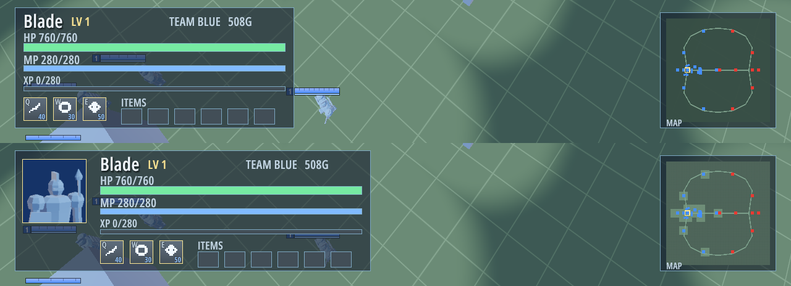

The networked golden frame (`MOBA_SERVER=local`, GPU-skinned heroes, pinned at tick 120),
cropped from 1280×720 lavapipe captures of this branch. Top: `MOBA_PORTRAITS=off
MOBA_MINIMAP_BAKE=off`, which reproduces the previous golden fingerprint exactly (difference
0). Bottom: the defaults.
- **Hero portrait:** a 3D render of the own hero's model (the skinned `sentinel` sample),
  lit by a studio key light over a dark team-coloured backdrop, in a new portrait column of
  the hero panel. It is one cell of a 2048×128 offscreen strip that the renderer's
  `portraits` pass draws with the scene pipelines, and the UI samples and tonemaps it.
- **Baked minimap:** the panel shows a top-down orthographic render of the map (terrain with
  a faint grid, walls, props), baked once into a 512×512 offscreen image when the map is
  bound. Outside allied vision it is darkened by a 24×24 grid built from the units the client
  was sent; lanes, unit dots and the own-hero frame are drawn on top as before.

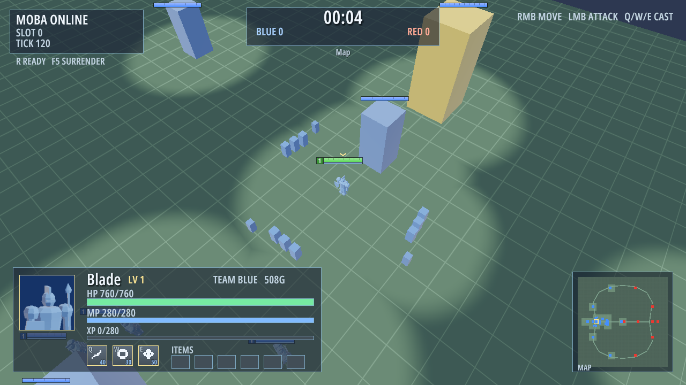

The full frame, which is the new networked golden.

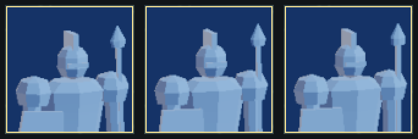

The portrait cell magnified 2×: at tick 120 and tick 135 on `High` (10 Hz, the idle clip of
the model's animation set plays through a per-cell animator: the spear and shoulders move),
and on `Low`, where the portrait is rendered once at rest (and the offscreen images use the
`B10G11R11_UFLOAT_PACK32` HDR format).

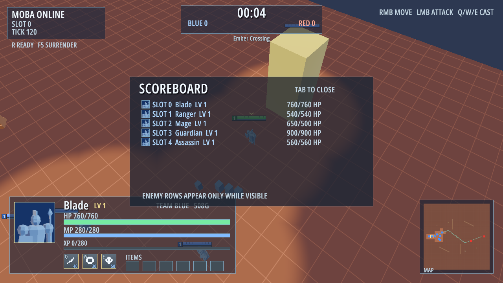

`MOBA_CONTENT=content/ember-map.toml MOBA_SCOREBOARD=1`: every scoreboard row leads with its
hero's portrait cell, and the baked minimap shows the map's rampart walls and crystal props
(the flat minimap drew only wall lines). Enemy rows and their portraits appear only while the
enemy is visible.

All R7b captures: lavapipe, `MOBA_VULKAN_VALIDATION=required` (validation plus
synchronisation validation), exit 0, zero validation messages, also at 2560×1440 with
`MOBA_UI_SCALE=2.0` and the scoreboard, and on `MOBA_QUALITY=low`. On the RTX 5070 Ti,
900 frames with the scoreboard open and a minimap re-bake every 20 frames
(`MOBA_MINIMAP_BAKE=20`) also gave zero messages.

```bash
MOBA_SERVER=local MOBA_HERO_MODELS=sentinel-skinned MOBA_SMOKE_FRAMES=100000 \
MOBA_CAPTURE_TICK=120 MOBA_CAPTURE=/tmp/net.ppm MOBA_VULKAN_VALIDATION=required \
cargo run --release -p moba-client
# before: + MOBA_PORTRAITS=off MOBA_MINIMAP_BAKE=off; idle: MOBA_CAPTURE_TICK=135;
# + MOBA_QUALITY=low; + MOBA_CONTENT=content/ember-map.toml MOBA_SCOREBOARD=1
```

**Golden rebaseline:** the networked fingerprint was **deliberately rebaselined** for R7b
(the hero panel's portrait column and the baked minimap). It was made exactly as
`render-golden.yml` makes it, on lavapipe with validation required; two runs gave
byte-identical PPMs, which read mean 3.270 / max 99 against the old fingerprint. The
default-scene golden is unchanged: the local preview's HUD has no portrait or minimap, and
its capture matches the old fingerprint with a difference of 0.

### Per-map visuals


`content/ember-map.toml` in the local preview, styled by its descriptor
`content/maps/ember.toml` (#287): scorched terrain tint, rust-red ramparts drawn with the
generated `content/models/rampart.glb` along the pack's four vision walls, and ember
`content/models/crystal.glb` props. Before #287 the local preview drew no walls at all. One
1280×720 lavapipe run with validation and synchronization validation required: exit 0, zero
validation messages, stderr only `[assets] map visuals 'ember' loaded (5 props)`.

```bash
MOBA_CONTENT=content/ember-map.toml MOBA_SMOKE_FRAMES=120 \
MOBA_CAPTURE=/tmp/ember.ppm MOBA_CAPTURE_FRAME=90 \
MOBA_VULKAN_VALIDATION=required cargo run --release -p moba-client
```


Two map packs rendering back to back in **one** client session (both 1280×720 frames, scaled
to half size). The server started on Ember Crossing with `--reload-content --ready`, the pack
file was then replaced atomically with `content/frost-map.toml`, and the server broadcast a
`ContentUpdate` in the lobby. The client rebound the map without restarting: left, Ember
Crossing (`ember`); right, Frost Ring (`frost`: snow tint, 9 m glacier-blue walls, sentinel
statues and ice pillars). Lavapipe with validation and synchronization validation required,
zero validation messages. The client's stderr was exactly:

```text
[assets] map visuals 'ember' loaded (5 props)
[capture] written to /tmp/switch-1.ppm
[assets] map visuals 'frost' loaded (5 props)
[capture] written to /tmp/switch-2.ppm
```

```bash
cp content/ember-map.toml /tmp/live.toml
cargo run --release -p moba-server -- --listen 127.0.0.1:7791 --seconds 150 \
  --items /tmp/live.toml --reload-content --ready &
MOBA_SERVER=127.0.0.1:7791 MOBA_CAPTURE_MAPS=/tmp/switch MOBA_CAPTURE_FRAME=40 \
MOBA_CAMERA=overview MOBA_VULKAN_VALIDATION=required cargo run --release -p moba-client &
# after /tmp/switch-1.ppm appears:
cp content/frost-map.toml /tmp/.live.toml.tmp && mv /tmp/.live.toml.tmp /tmp/live.toml
```

Map rotation (`--items A --items B`) takes the same client path after each match. The default
golden scene names no visuals and ships no `map-*` descriptor, so it is unchanged.

## Reproducing a capture

The client supports headless readback without changing the renderer:

```bash
MOBA_SERVER=local \
MOBA_SMOKE_FRAMES=240 \
MOBA_CAPTURE=/tmp/frame.ppm \
MOBA_CAPTURE_FRAME=220 \
cargo run -p moba-client
```

For the software Vulkan setup used here, see [software Vulkan](dev/software-vulkan.md).
