# Screenshots

Captures from the Linux client with headless readback (PPM/PNG). Most were taken under Mesa
lavapipe; the renderer captures in M3 were taken with validation required. UI and art are
preview-quality and will evolve.

## Renderer and simulation

### Animated hero rig


Local preview with procedural multi-part hero rigs (torso/head/arms/legs) animated from the
deterministic simulation tick; minions and structures retain the instanced-cube path.

### Real NVIDIA hardware (1920×1080)
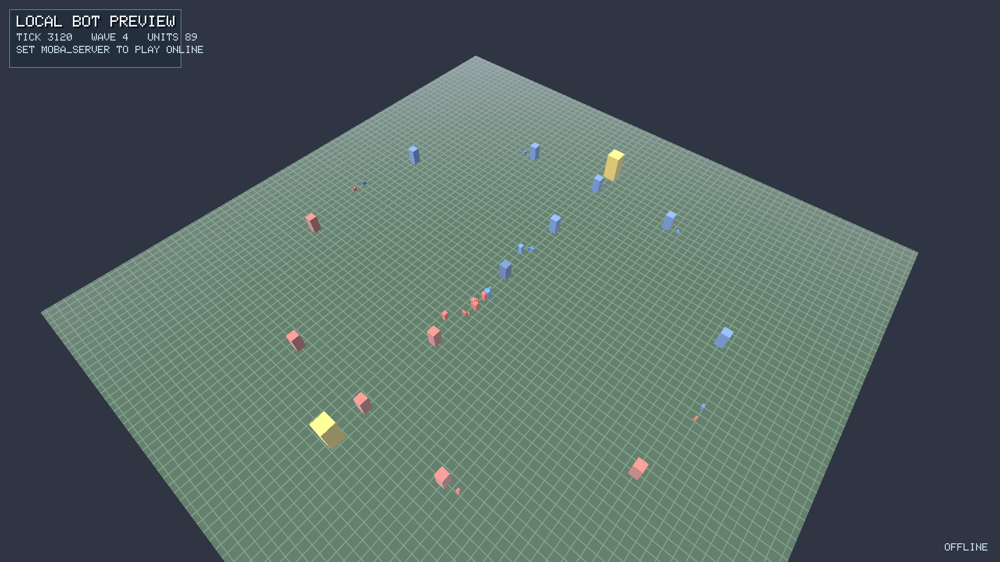

Local bot preview after 3,000 warmup ticks on an RTX 5070 Ti with validation required; frame log
p95 4.197 ms / max 4.538 ms with vsync off.

### 500 instanced units + terrain
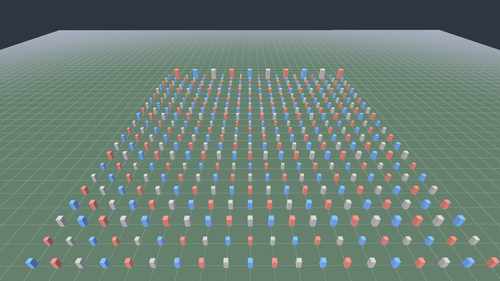

Renderer stress capture at 1920×1080: instanced units, terrain grid, team colours and clear
colour. Validation produced zero messages.

### Simulation slice
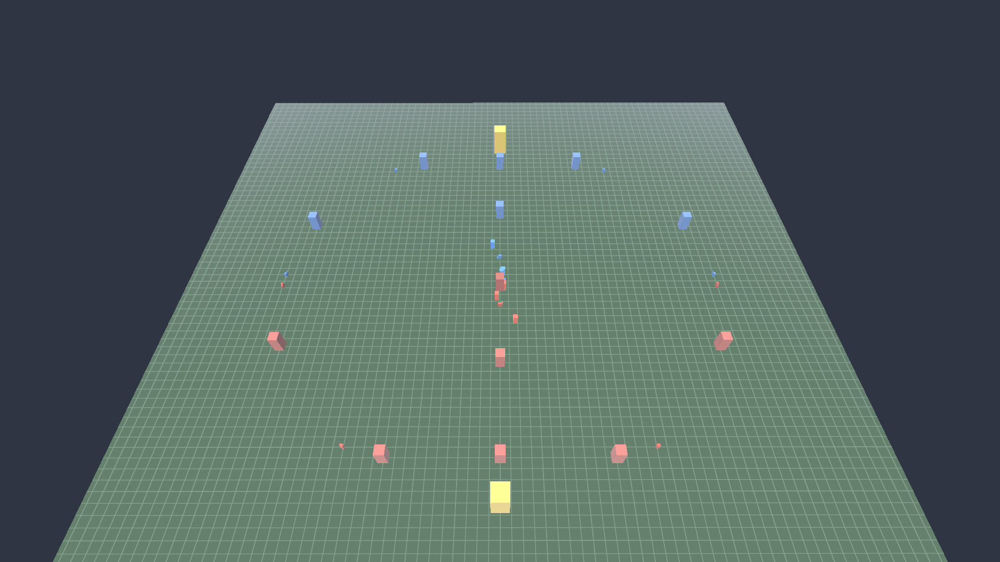

Headless-produced match rendered by the client, showing lanes, structures, heroes and
projectiles.

## Networked client and HUD

### Networked client
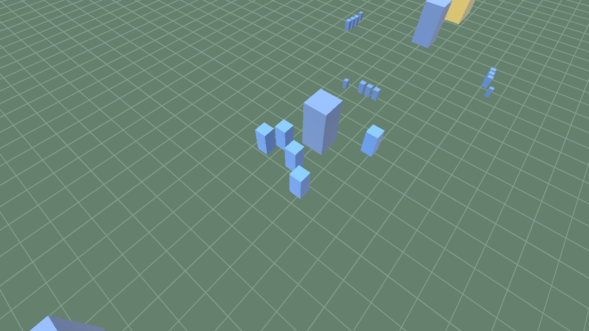

Client connected over UDP with predicted local hero and interpolated remote units.

### HUD and fog of war


Health/mana/XP, ability cooldowns, items, timer and team score, with terrain fog of war.

### Countdown
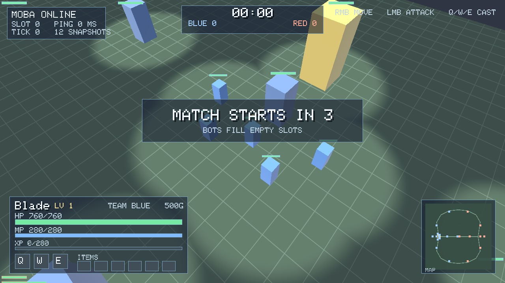

Lobby-to-match countdown, ready state and roster.

### Minimap and floating health bars


Minimap with lanes and team dots, plus world-space health bars.

### Scoreboard
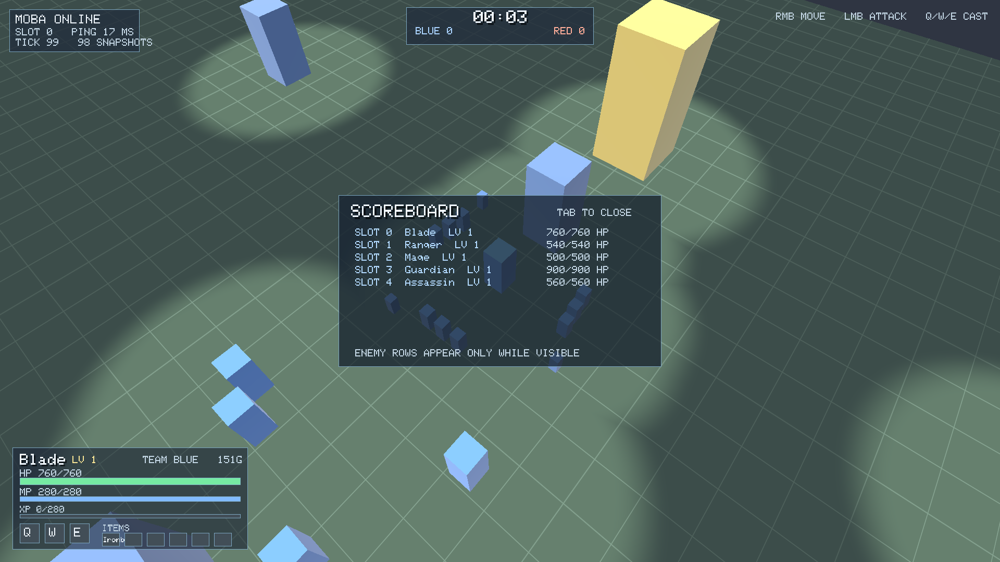

Tab scoreboard with both teams, levels and health.

### Shop
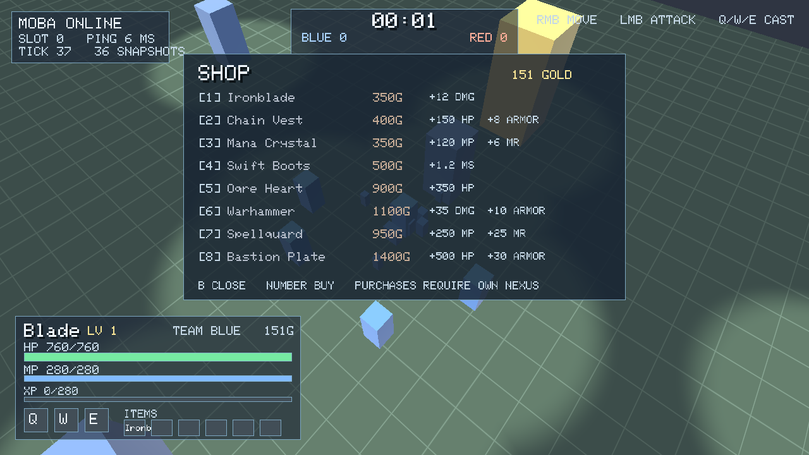

Runtime item catalogue, costs and affordability; the live shop supports arrow-key paging for
packs with more than eight items.

### Progression
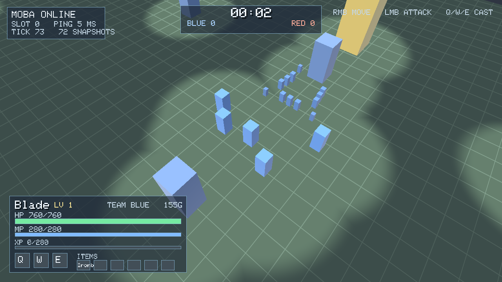

XP, gold, level and purchased item state after combat.

### Ready lobby
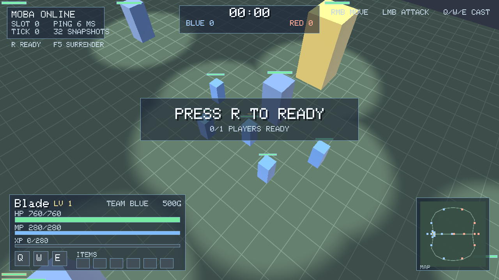

Ready-up gating before the countdown starts.

### Custom map theme (snow ARAM)
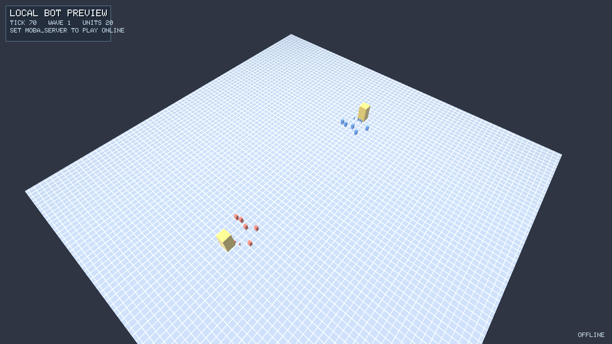

The ARAM pack sets `[map] theme = "snow"`; the client selects the built-in snow terrain/wall
palette without recompiling. Captured with `MOBA_CONTENT=content/aram.toml` on lavapipe.

## Vision, status and spectator

### Wall line-of-sight fog
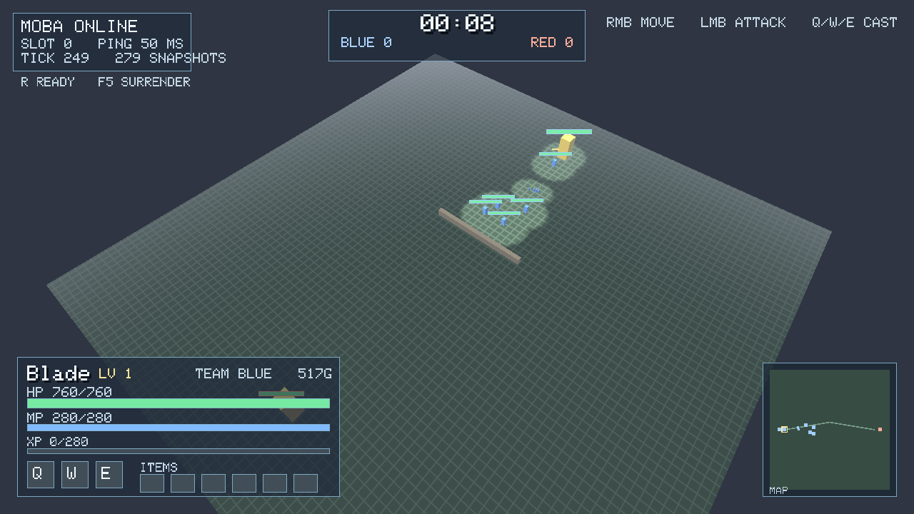

Custom map wall geometry and wall-aware fog: vision circles are clipped where a wall crosses
the source-to-fragment ray.

### Minimap walls and frame diagnostics


Walls rendered on the minimap, the smoothed FPS/frame-time diagnostic, and the full HUD.

### Status icons
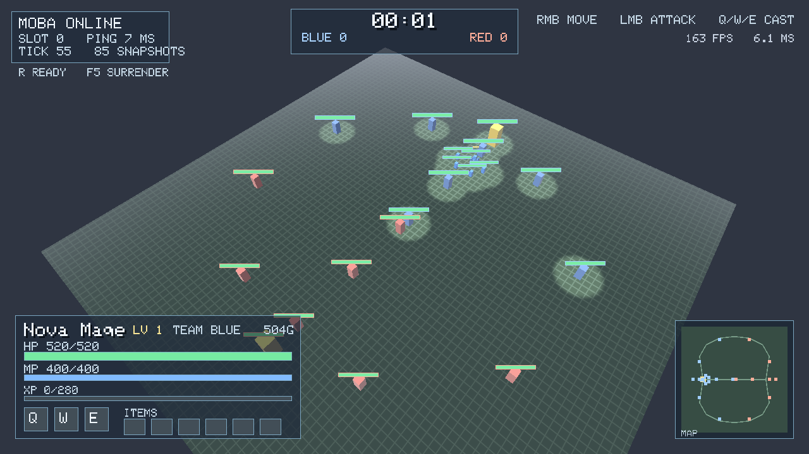

Health-bar icons for shield, slow, root, silence, burn and haste; units also receive a
status tint.

### Spectator view
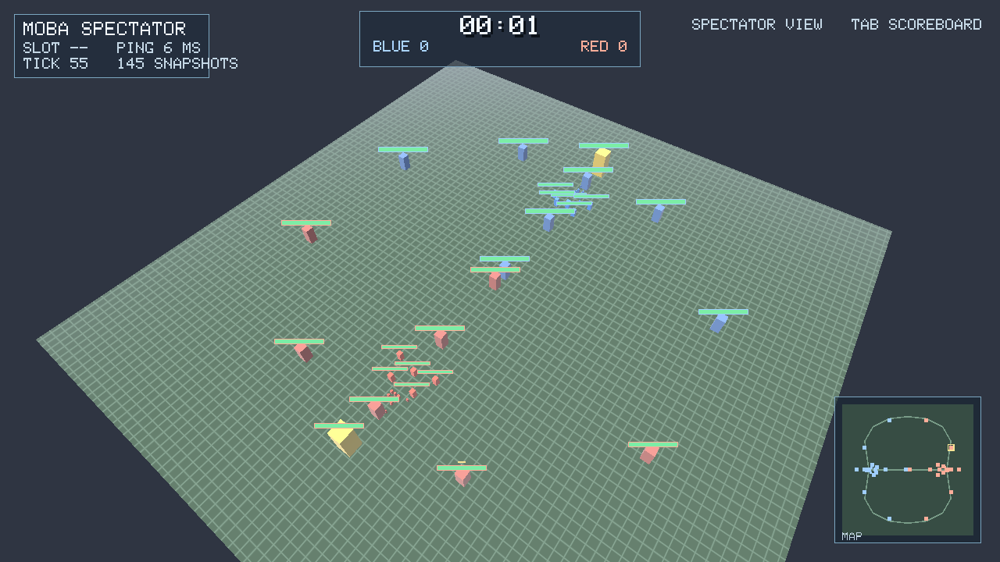

Read-only spectator with both teams visible and no player slot.

### Free-pan spectator camera
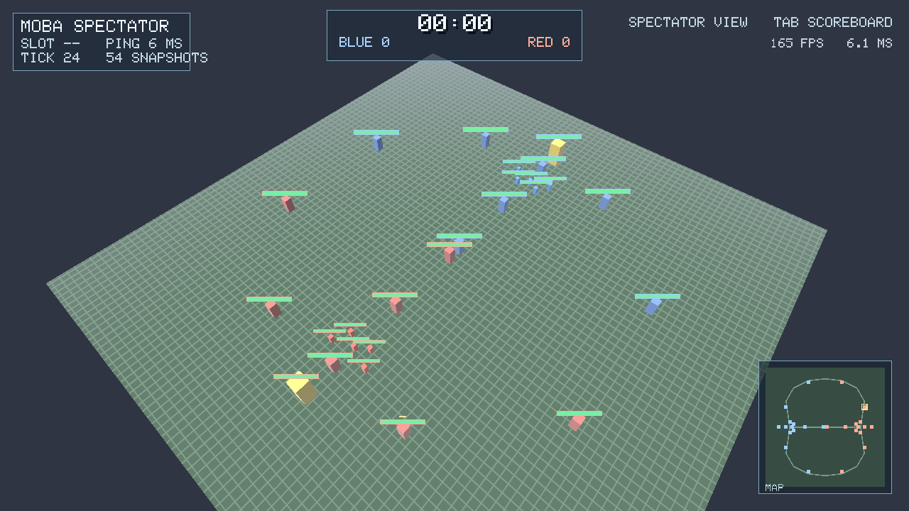

Spectator camera panned/zoomed with WASD and arrows; full-map visibility is retained.

## Runtime content

### Custom hero content
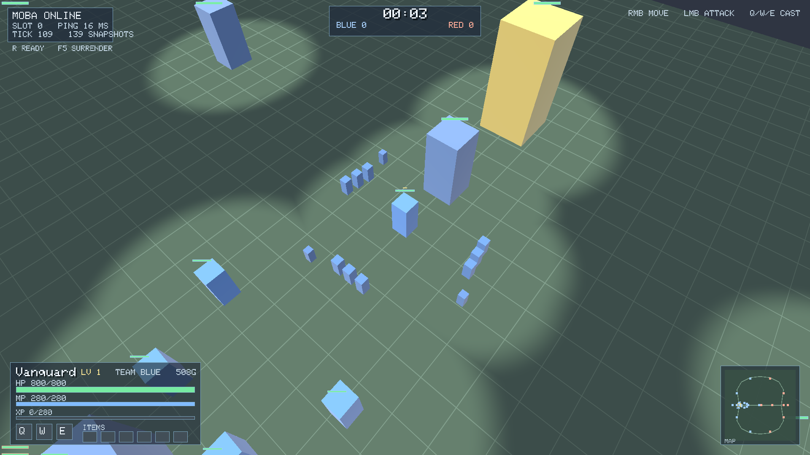

Client using a runtime pack's custom Vanguard hero, stats and name.

### Custom map content
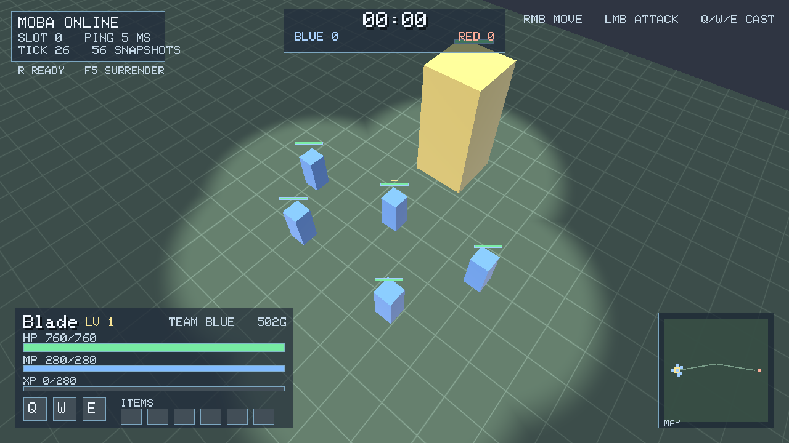

One-lane map pack with custom structures/spawns and minimap geometry.

### Custom hero model (.glb)
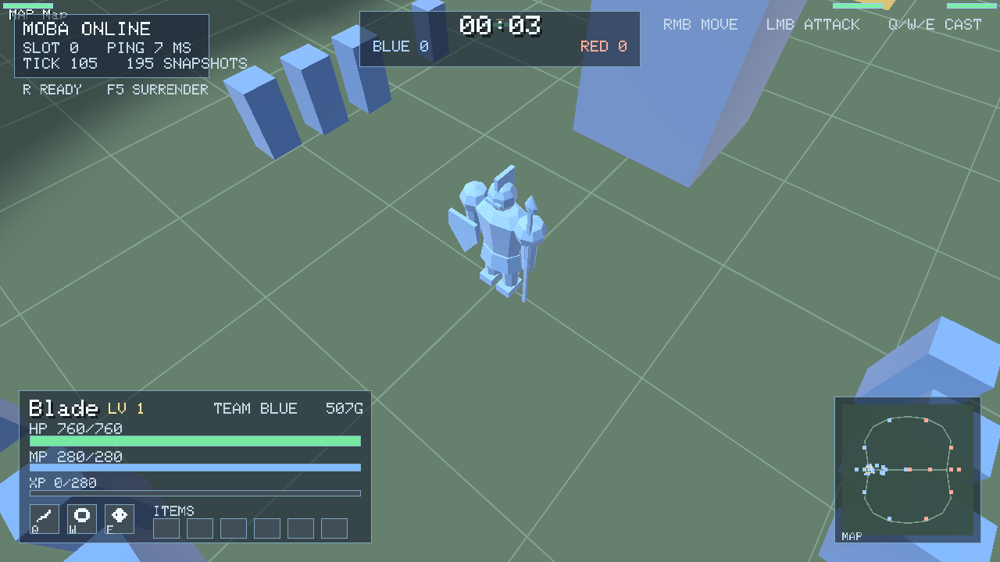

Local networked match (`MOBA_SERVER=local`) with the shipped `content/models/sentinel.glb`
loaded from the client-local asset root and drawn through `Renderer::register_mesh` and the
per-mesh instanced draw (ADR-0007). Minions and structures stay on the cube mesh in the same
frame. Lavapipe, 1280×720, validation and synchronization validation required, zero messages.
The camera is pulled in with `MOBA_CAMERA_DISTANCE=12`:

```bash
MOBA_SERVER=local MOBA_HERO_MODELS=Blade=sentinel,Guardian=sentinel,Mage=sentinel \
MOBA_CAMERA_DISTANCE=12 MOBA_SMOKE_FRAMES=1000 \
MOBA_CAPTURE=/tmp/frame.ppm MOBA_CAPTURE_FRAME=960 \
MOBA_VULKAN_VALIDATION=required cargo run -p moba-client
```

A missing, path-escaping or truncated model logs one `[assets]` line and that hero keeps the
procedural rig.

### Textured material (R1b)
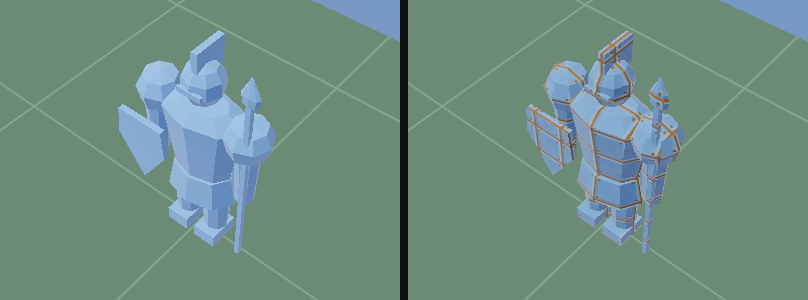

The same networked frame (tick 120, `MOBA_CAPTURE_TICK`) without and with the sample material
`content/materials/sentinel.toml` (ADR-0010): left, `main` at `6e809f0` (vertex colour); right,
this build drawing the static `sentinel.glb` with the `MATERIAL_TEXTURED` permutation, a BC7
base colour, a BC5 normal map and a BC4 team mask (the painted plates take the blue team colour,
the bronze seams and rivets do not). All textures are self-generated (`texture-bake generate
sentinel`). Lavapipe, 1280×720, validation and synchronization validation required, zero
messages; 400×300 crops around the hero. Decoding the BC textures on the CPU instead
(`MOBA_COMPRESSED_TEXTURES=0`) changes no channel by more than one 8-bit step.

```bash
MOBA_SERVER=local MOBA_HERO_MODELS=Blade=sentinel,Guardian=sentinel,Mage=sentinel \
MOBA_CAMERA_DISTANCE=10 MOBA_CAPTURE_TICK=120 MOBA_SMOKE_FRAMES=100000 \
MOBA_CAPTURE=/tmp/frame.ppm MOBA_VULKAN_VALIDATION=required cargo run --release -p moba-client
```

### GPU-skinned hero (walk cycle)
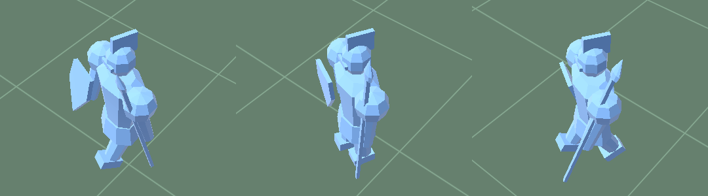

Three captures (frames 400, 404 and 408) of the own hero walking in a local networked match,
drawn with the shipped `content/models/sentinel-skinned.glb` through
`Renderer::register_skinned_mesh` (`skinned.vert`, per-frame bone buffer, push-constant bone
range; WP-4.1, #288). The pose comes from the hero's interpolated movement (gait) and the render
tick: arms, spear and legs counter-swing, the chest twists and the hips bob. Each crop is from a
separate 1280×720 lavapipe run with validation and synchronization validation required: exit 0
and zero validation messages (stderr is only `[assets] model 'sentinel-skinned' loaded
(skinned)`). The default golden scene has no models and is unchanged.

```bash
MOBA_SERVER=local MOBA_HERO_MODELS=sentinel-skinned MOBA_CAMERA_DISTANCE=10 \
MOBA_DEMO_MOVE=200,200 MOBA_SMOKE_FRAMES=420 \
MOBA_CAPTURE=/tmp/frame.ppm MOBA_CAPTURE_FRAME=400 \
MOBA_VULKAN_VALIDATION=required cargo run --release -p moba-client
```

`MOBA_NO_SKINNING=1` draws the same model as a static mesh (stride bob only); a model without
a skin is always static, and a missing model keeps the procedural rig.

### Networked golden: skinned heroes at a pinned tick
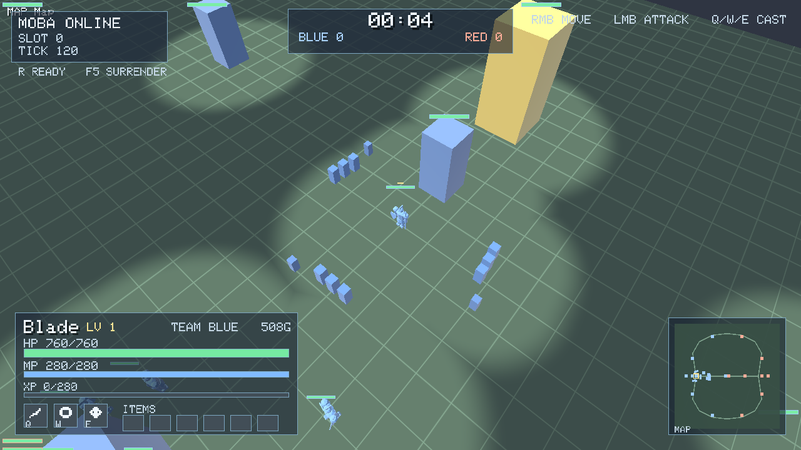

This is the frame behind the second render-golden fingerprint,
`tests/golden/render-network-fingerprint.rgb` (WP-4.2, #289).
- **Setup:** an in-process loopback server (`MOBA_SERVER=local`) with GPU-skinned heroes.
- **Capture point:** `MOBA_CAPTURE_TICK=120`. The local server is lock-stepped to the client and
  stops at tick 120, and interpolation and animation are pinned to that tick. The bots' heroes
  walk (bottom of the frame) while the idle local hero stands in its rest pose at the centre.
- **Capture mode:** the HUD leaves out the FPS, ping and packet counters.
- **Repeatable:** two lavapipe runs at 1280×720 with validation and synchronization validation
  required produced byte-identical PPMs, with zero validation messages.

```bash
MOBA_SERVER=local MOBA_HERO_MODELS=sentinel-skinned MOBA_CAPTURE_TICK=120 \
MOBA_SMOKE_FRAMES=100000 MOBA_CAPTURE=/tmp/frame.ppm \
MOBA_VULKAN_VALIDATION=required cargo run --release -p moba-client
```

### HDR target and AgX tonemap (R1a): before and after
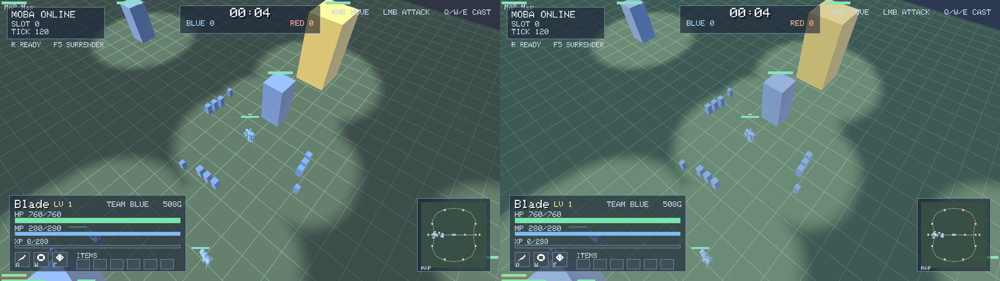

The same networked golden frame (tick 120, lavapipe, 1280×720), before and after R1a
([ADR-0008](adr/0008-render-graph.md)).
- **Left:** the old single forward pass straight into the swapchain.
- **Right:** the render graph. The scene renders into an `R16G16B16A16_SFLOAT` target, a
  composite pass applies exposure and AgX with a saturation look, and the HUD is drawn
  afterwards.
- **What changed:** shadows and mid-tones are almost unchanged. Highlights roll off (the lit
  structures are dimmer), and team colours keep their hue. HUD pixels are identical, because the
  UI is never tonemapped.
- **Rebaseline:** this is the deliberate rebaseline of both golden fingerprints. Validation and
  synchronisation validation reported zero messages, and two runs gave identical fingerprints.

### Per-map visuals
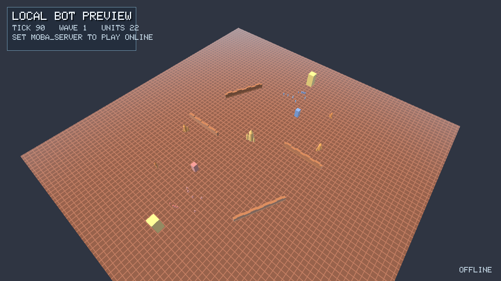

`content/ember-map.toml` in the local preview, styled by its descriptor
`content/maps/ember.toml` (#287): scorched terrain tint, rust-red ramparts drawn with the
generated `content/models/rampart.glb` along the pack's four vision walls, and ember
`content/models/crystal.glb` props. Before #287 the local preview drew no walls at all. One
1280×720 lavapipe run with validation and synchronization validation required: exit 0, zero
validation messages, stderr only `[assets] map visuals 'ember' loaded (5 props)`.

```bash
MOBA_CONTENT=content/ember-map.toml MOBA_SMOKE_FRAMES=120 \
MOBA_CAPTURE=/tmp/ember.ppm MOBA_CAPTURE_FRAME=90 \
MOBA_VULKAN_VALIDATION=required cargo run --release -p moba-client
```

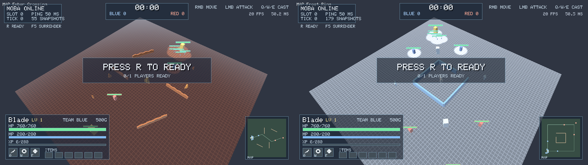

Two map packs rendering back to back in **one** client session (both 1280×720 frames, scaled
to half size). The server started on Ember Crossing with `--reload-content --ready`, the pack
file was then replaced atomically with `content/frost-map.toml`, and the server broadcast a
`ContentUpdate` in the lobby. The client rebound the map without restarting: left, Ember
Crossing (`ember`); right, Frost Ring (`frost`: snow tint, 9 m glacier-blue walls, sentinel
statues and ice pillars). Lavapipe with validation and synchronization validation required,
zero validation messages. The client's stderr was exactly:

```text
[assets] map visuals 'ember' loaded (5 props)
[assets] map capture written to /tmp/switch-1.ppm
[assets] map visuals 'frost' loaded (5 props)
[assets] map capture written to /tmp/switch-2.ppm
```

```bash
cp content/ember-map.toml /tmp/live.toml
cargo run --release -p moba-server -- --listen 127.0.0.1:7791 --seconds 150 \
  --items /tmp/live.toml --reload-content --ready &
MOBA_SERVER=127.0.0.1:7791 MOBA_CAPTURE_MAPS=/tmp/switch MOBA_CAPTURE_FRAME=40 \
MOBA_CAMERA=overview MOBA_VULKAN_VALIDATION=required cargo run --release -p moba-client &
# after /tmp/switch-1.ppm appears:
cp content/frost-map.toml /tmp/.live.toml.tmp && mv /tmp/.live.toml.tmp /tmp/live.toml
```

Map rotation (`--items A --items B`) takes the same client path after each match. The default
golden scene names no visuals and ships no `map-*` descriptor, so it is unchanged.

## Reproducing a capture

The client supports headless readback without changing the renderer:

```bash
MOBA_SERVER=local \
MOBA_SMOKE_FRAMES=240 \
MOBA_CAPTURE=/tmp/frame.ppm \
MOBA_CAPTURE_FRAME=220 \
cargo run -p moba-client
```

For the software Vulkan setup used here, see [software Vulkan](dev/software-vulkan.md).
